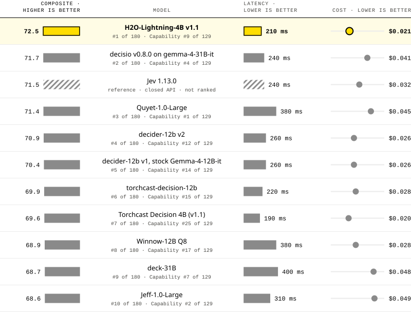
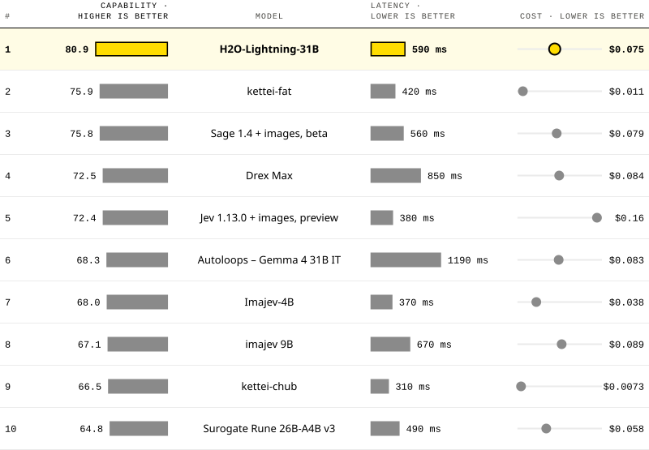
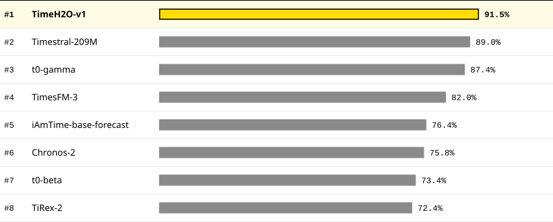
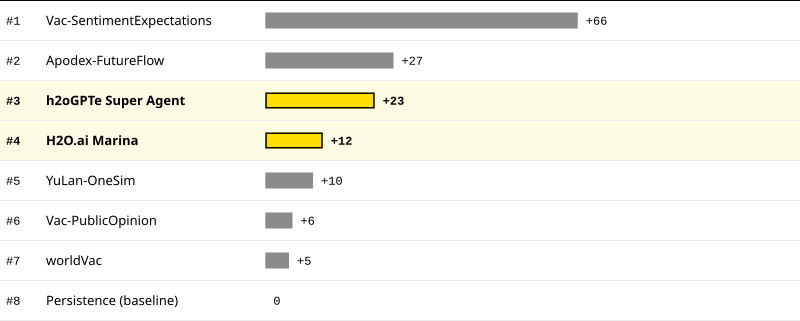
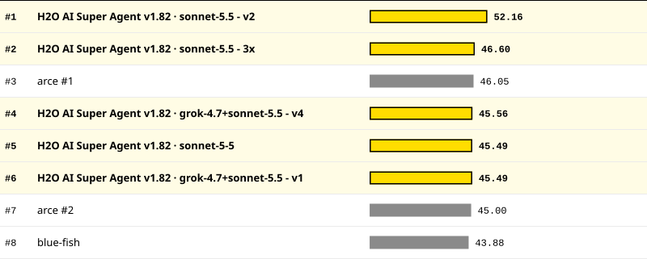
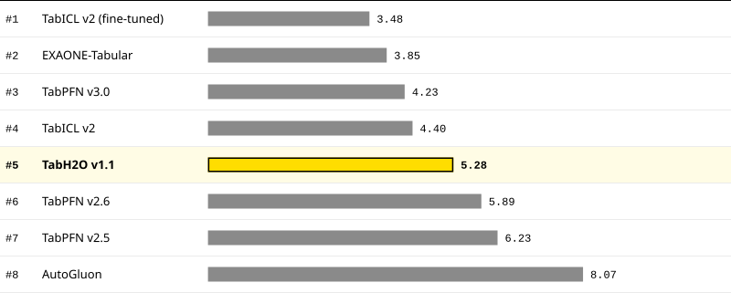
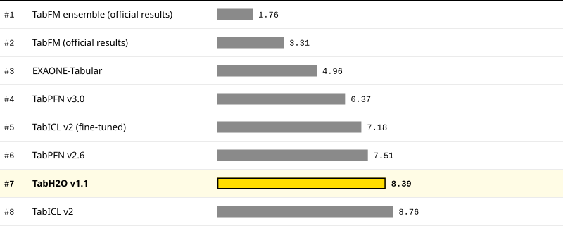

<!-- Generated by `python3 -m landing build` from data/ and landing/; edit those, not this file. -->

# H2O.ai Benchmarks

Models and agents you can run in your own environment, measured on the public leaderboards where the field competes.

## Top leaderboard ranks · read 24 Oct 2026

| Kind | Benchmark | H2O entry | Rank | Link |
|---|---|---|---|---|
| Generative | ImageJevBench Capability | H2O-Lightning-31B | **#1** of 54 | [Model card ↗](https://huggingface.co/h2oai/h2o-lightning-31b) |
| Predictive | fev-bench | TimeH2O-v1 | **#1** of 32 | [Model card ↗](https://huggingface.co/h2oai/timeh2o-v1) |
| Agentic | Social Simulation Arena | H2O AI Super Agent | **#1** of 24 | [Enterprise h2oGPTe ↗](https://h2o.ai/products/h2ogpte) |
| Agentic | FutureX | H2O AI Super Agent | **#1** of 24 | [Enterprise h2oGPTe ↗](https://h2o.ai/products/h2ogpte) |
| Generative | JevBench Composite | H2O-Lightning-4B | **#2** of 197 | [Model card ↗](https://huggingface.co/h2oai/h2o-lightning-4b) |
| Agentic | Social Simulation Arena | H2O AI Marina | **#3** of 24 | [H2O AI Marina ↗](https://h2oai.github.io/marina/) |
| Predictive | TALENT | TabH2O | **#5** of 13 | [Try it live ↗](https://tabh2o.h2oai.com/) |
| Predictive | TabArena | TabH2O | **#7** of 39 | [Try it live ↗](https://tabh2o.h2oai.com/) |

[JevBench](#jevbench) · [ImageJevBench](#imagejevbench) · [fev-bench](#fev-bench) · [Social Simulation Arena](#social-simulation-arena) · [FutureX](#futurex) · [TabH2O](#tabh2o)

## JevBench

*Generative AI · Decision models*

### #2 of 197 on JevBench

**H2O-Lightning-4B ranks #2 of 197 on the JevBench Composite score for open-weights systems**

Decision models get a situation and typed questions and must return calibrated answers, scored on intelligence, calibration, speed and cost. A 4B model with open weights.

| Composite score | latency incl. network, board estimate | per 1,000 decisions, board estimate |
|---|---|---|
| **73.8** | **0.21 s** | **\$0.016** |

[Leaderboard ↗](https://benchmarkheaven.com/jev-models) · [How it scores ↗](https://benchmarkheaven.com/jev-models/methodology) · [H2O blog post ↗](https://h2o.ai/blog/2026/h2o-lightning-jevbench) · [Model card ↗](https://huggingface.co/h2oai/h2o-lightning-4b)

**Composite, latency and cost, side by side** · Composite top 10 · sorted by Composite · higher is better

<picture>
<source media="(prefers-color-scheme: dark)" srcset="readme/jevbench-dark.svg">

</picture>

Composite, latency and cost, side by side

| # | Composite · higher is better | Model | Latency · lower is better | Cost · lower is better |
|:---|---:|:---:|---|---:|
| 1 | 76.2 | Torchcast Decision 4B (v1.3) | 220 ms | \$0.015 |
| **2** | **73.8** | **H2O-Lightning-4B v1.1** | **210 ms** | **\$0.016** |
| **3** | **73.4** | **H2O-Lightning-31B v1.0.7** | **280 ms** | **\$0.044** |
| 4 | 73.0 | Torchcast Decision 4B (v1.2) | 270 ms | \$0.015 |
| 5 | 71.7 | decisio v0.8.0 on gemma-4-31B-it | 240 ms | \$0.041 |
| 6 | 71.7 | basal-omni-1.0-ultra | 350 ms | \$0.045 |
|  | 71.5 | Jev 1.13.0 reference · closed API · not ranked | 240 ms | \$0.032 |
| 7 | 71.4 | Quyet-1.0-Large | 380 ms | \$0.045 |
| 8 | 70.9 | decider-12b v2 | 260 ms | \$0.026 |
| 9 | 70.7 | Torchcast Decision 4B (v1.1) | 190 ms | \$0.015 |
| 10 | 70.4 | decider-12b v1, stock Gemma-4-12B-it | 260 ms | \$0.026 |
|  | 70.2 | Jev 1.14.0 reference · closed API · not ranked | 220 ms | \$0.032 |

Hatched: the board's Jev reference, a closed API listed but not ranked. Composite ranks 197 open-weights systems; Capability, the board's headline score, ranks the 140 inside its cost and latency caps. Latency includes network: for self-hosted models the board estimates it as 2 × its measured GPU time + 150 ms. Cost is the board's estimate. Benchmark Heaven, board v1.7.47.

## ImageJevBench

*Generative AI · Image decision models*

### #1 of 54 on ImageJevBench Capability

**H2O-Lightning-31B ranks #1 of 54 on ImageJevBench Capability, the board's headline score**

Image decision models answer typed questions about a picture and must return calibrated answers, scored on intelligence, calibration, speed and cost. An open-weights model.

| Capability score | latency incl. network, board estimate | per 1,000 decisions, at the board's GPU rate |
|---|---|---|
| **80.9** | **0.59 s** | **\$0.075** |

[Leaderboard ↗](https://benchmarkheaven.com/image-jev-bench) · [How it scores ↗](https://benchmarkheaven.com/jev-models/methodology) · [Model card ↗](https://huggingface.co/h2oai/h2o-lightning-31b)

**Capability, latency and cost, side by side** · Capability top 10 · sorted by Capability · higher is better

<picture>
<source media="(prefers-color-scheme: dark)" srcset="readme/imagejevbench-dark.svg">

</picture>

Capability, latency and cost, side by side

| # | Capability · higher is better | Model | Latency · lower is better | Cost · lower is better |
|:---|---:|:---:|---|---:|
| **1** | **80.9** | **H2O-Lightning-31B** | **590 ms** | **\$0.075** |
| 2 | 75.9 | kettei-fat | 420 ms | \$0.011 |
| 3 | 75.8 | Sage 1.4 + images, beta | 560 ms | \$0.079 |
| 4 | 72.5 | Drex Max | 850 ms | \$0.084 |
| 5 | 72.4 | Jev 1.13.0 + images, preview | 380 ms | \$0.16 |
| 6 | 68.3 | Autoloops – Gemma 4 31B IT | 1190 ms | \$0.083 |
| 7 | 68.0 | Imajev-4B | 370 ms | \$0.038 |
| 8 | 67.1 | imajev 9B | 670 ms | \$0.089 |
| 9 | 66.5 | kettei-chub | 310 ms | \$0.0073 |
| 10 | 64.8 | Surogate Rune 26B-A4B v3 | 490 ms | \$0.058 |

Capability, the board's headline score, ranks the 54 Jev-class systems: those inside 2 × the cost and median latency of the board's Jev reference. On the board's official Composite H2O-Lightning-31B is #5 of 63. Latency includes network: for self-hosted models the board estimates it as 2 × its measured GPU time + 150 ms. A self-hosted system's cost is its measured GPU time at the board's hourly rate. Benchmark Heaven, board v0.3.0.

## fev-bench

*Predictive AI · Time-series forecasting*

### #1 of 32 on fev-bench

**TimeH2O-v1 ranks #1 of 32 on the fev-bench leaderboard, by win rate**

Zero-shot forecasting on real time series across many domains and frequencies, scored by probabilistic accuracy against a seasonal-naive baseline. 108.8M parameters.

| win rate | skill score | parameters |
|---|---|---|
| **91.9%** | **50.8%** | **108.8M** |

[Leaderboard ↗](https://huggingface.co/spaces/autogluon/fev-bench) · [fev-bench paper ↗](https://arxiv.org/abs/2509.26468) · [Model card ↗](https://huggingface.co/h2oai/timeh2o-v1)

**Win rate · top 8 of 32** · higher is better

<picture>
<source media="(prefers-color-scheme: dark)" srcset="readme/fev-bench-dark.svg">

</picture>

Win rate · top 8 of 32

| Rank | Entry | Win rate |
|---:|---|---:|
| **#1** | **TimeH2O-v1** | **91.9%** |
| #2 | Timestral-209M | 89.6% |
| #3 | t0-gamma | 88.1% |
| #4 | TimesFM-3 | 82.7% |
| #5 | Chronos-2 | 76.8% |
| #6 | t0-beta | 74.5% |
| #7 | TiRex-2 | 73.5% |
| #8 | Toto-2.0-2.5B | 73.0% |

Default leaderboard view. With the closed-API models included it is #2 of 36. TimeH2O-v1 has a non-commercial licence.

## Social Simulation Arena

*Agentic AI · Social forecasting*

### #1 of 24 on Social Simulation Arena

**H2O AI Super Agent ranks #1 of 24 on Social Simulation Arena's Season 0 pairwise win rate**

Entrants forecast the next public release of poll, sentiment and attention series. Forecasts are locked before the answer exists and scored against the published number.

| pairwise win rate | questions answered | H2O AI Super Agent | H2O AI Marina |
|---|---|---|---|
| **66.18** | **41** | **#1** | **#3** |

[Leaderboard ↗](https://social-simulation-arena.com/#leaderboard) · [How scoring works ↗](https://social-simulation-arena.com/docs.html) · [Enterprise h2oGPTe ↗](https://h2o.ai/products/h2ogpte) · [H2O AI Marina ↗](https://h2oai.github.io/marina/)

**Pairwise win rate · top 8 of 24** · higher is better

<picture>
<source media="(prefers-color-scheme: dark)" srcset="readme/social-simulation-arena-dark.svg">

</picture>

Pairwise win rate · top 8 of 24

| Rank | Entry | Pairwise win rate |
|---:|---|---:|
| **#1** | **H2O AI Super Agent** | **66.18** |
| #2 | Apodex-FutureFlow | 65.46 |
| **#3** | **H2O AI Marina** | **61.70** |
| #4 | Claude Sonnet 5 · web+sfc | 57.47 |
| #5 | Crowd (baseline) | 56.17 |
| #6 | Vac | 55.35 |
| #7 | worldVac | 54.43 |
| #8 | Gemini 3.1 Pro · web | 53.81 |

The site's default view: Season 0 pairwise win rate, 41 questions locked from 30 Sep 2026, one row per method. By arena score over every resolved number question Super Agent is #3 of 25 and Marina #4; by arena score on the Season 0 main board Super Agent is #5 of 26 and Marina #6. Entrants answer different numbers of questions.

## FutureX

*Agentic AI · Future prediction*

### 25 FutureX medals, 8 of them first places

**H2O AI Super Agent ranks #1 of 24 on FutureX's weekly board for 2026 Oct. Week 2**

Agents predict real-world events before they resolve, with a new board every week, scored once the answers are known.

| latest weekly board | first places | weekly boards with a medal, of 43 entered |
|---|---|---|
| **#1 of 24** | **8** | **18** |

[Leaderboard ↗](https://futurex.live/) · [FutureX paper ↗](https://arxiv.org/abs/2508.11987) · [Enterprise h2oGPTe ↗](https://h2o.ai/products/h2ogpte)

**Overall score, weekly board · top 8 of 24** · higher is better

<picture>
<source media="(prefers-color-scheme: dark)" srcset="readme/futurex-dark.svg">

</picture>

Overall score, weekly board · top 8 of 24

| # | Model | Framework | Organization | Score |
|---:|---|---|---|---:|
| **1** | **sonnet-5.5 - v2** | **H2O AI Super Agent v1.82** | **h2o.ai** | **52.16** |
| **2** | **sonnet-5.5 - 3x** | **H2O AI Super Agent v1.82** | **h2o.ai** | **46.60** |
| 3 | GLM 5.2 | arce #1 | Indiv. AI Researcher | 46.05 |
| **4** | **grok-4.7+sonnet-5.5 - v4** | **H2O AI Super Agent v1.82** | **h2o.ai** | **45.56** |
| **5** | **sonnet-5-5** | **H2O AI Super Agent v1.82** | **h2o.ai** | **45.49** |
| **6** | **grok-4.7+sonnet-5.5 - v1** | **H2O AI Super Agent v1.82** | **h2o.ai** | **45.49** |
| 7 | GLM 5.2 | arce #2 | Indiv. AI Researcher | 45.00 |
| 8 | blue-fish | blue-fish | Google DeepMind | 43.88 |

Best of 8 H2O submissions. The agent runs on third-party base LLMs; medals count every H2O entry.

## TabH2O

*Predictive AI · Tabular foundation models*

### #5 of 13 on TALENT · #7 of 39 on TabArena

**TabH2O ranks #5 of 13 on TALENT and #7 of 39 on TabArena**

Two public benchmark suites of tabular classification and regression datasets, comparing tabular foundation models, AutoML and tuned gradient boosting.

| TALENT | TabArena |
|---|---|
| **#5 of 13** | **#7 of 39** |

[TALENT ↗](https://github.com/LAMDA-Tabular/TALENT) · [TabArena ↗](https://tabarena.ai) · [Introducing TabH2O ↗](https://h2o.ai/blog/2026/h2oai-unveils-tabh2o-at-dell-technologies-world-2026) · [TabH2O paper ↗](https://arxiv.org/abs/2605.18383) · [TabH2O ↗](https://h2o.ai/products/tabh2o)

> *Try it now*
>
> Run TabH2O on your own table in the browser, then get an API key for the REST endpoint.
>
> [Open the playground ↗](https://tabh2o.h2oai.com/)

**TALENT · average rank across datasets · top 8 of 13** · lower is better

<picture>
<source media="(prefers-color-scheme: dark)" srcset="readme/tabh2o-1-dark.svg">

</picture>

TALENT · average rank across datasets · top 8 of 13

| Rank | Entry | Average rank across datasets |
|---:|---|---:|
| #1 | TabICL v2 (fine-tuned) | 3.48 |
| #2 | EXAONE-Tabular | 3.85 |
| #3 | TabPFN v3.0 | 4.23 |
| #4 | TabICL v2 | 4.40 |
| **#5** | **TabH2O v1.1** | **5.28** |
| #6 | TabPFN v2.6 | 5.89 |
| #7 | TabPFN v2.5 | 6.23 |
| #8 | AutoGluon | 8.07 |

**TabArena · average rank across datasets · top 8 of 39** · lower is better

<picture>
<source media="(prefers-color-scheme: dark)" srcset="readme/tabh2o-2-dark.svg">

</picture>

TabArena · average rank across datasets · top 8 of 39

| Rank | Entry | Average rank across datasets |
|---:|---|---:|
| #1 | TabFM ensemble (official results) | 1.76 |
| #2 | TabFM (official results) | 3.31 |
| #3 | EXAONE-Tabular | 4.96 |
| #4 | TabPFN v3.0 | 6.37 |
| #5 | TabICL v2 (fine-tuned) | 7.18 |
| #6 | TabPFN v2.6 | 7.51 |
| **#7** | **TabH2O v1.1** | **8.39** |
| #8 | TabICL v2 | 8.76 |

---

Leaderboards read 24 Oct 2026. Each board ranks its own field.

[Download all data (CSV)](site/data/h2o-benchmarks.csv)
