<!-- benchmarks:begin -->
<!-- Generated from the benchmark data; do not edit by hand. -->

<h1>Leading AI in  Predictive, Generative, and Agentic AI.</h1>

Benchmark data read on November 5, 2026.

[Overview](#overview-cards) · [Featured](#featured) · [fev-bench](#fev-bench) · [ImageJevBench](#imagejevbench) · [JevBench](#jevbench) · [TabH2O](#tabh2o) · [FutureX](#futurex) · [Social Simulation Arena](#social-simulation-arena)

## Overview

<picture>
  <source media="(prefers-color-scheme: dark)" srcset="readme/carousel-6-overview-dark.png">
  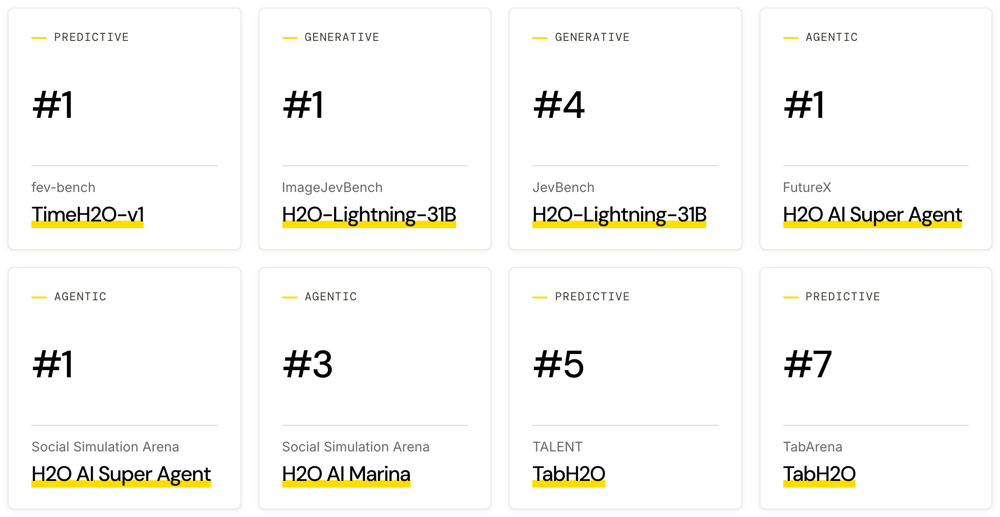
</picture>

| Category | Rank | Benchmark | Model |
| --- | --- | --- | --- |
| Predictive | #1 | fev-bench | TimeH2O-v1 |
| Generative | #1 | ImageJevBench | H2O-Lightning-31B |
| Generative | #4 | JevBench | H2O-Lightning-31B |
| Agentic | #1 | FutureX | H2O AI Super Agent |
| Agentic | #1 | Social Simulation Arena | H2O AI Super Agent |
| Agentic | #3 | Social Simulation Arena | H2O AI Marina |
| Predictive | #5 | TALENT | TabH2O |
| Predictive | #7 | TabArena | TabH2O |

## H2O vs Major AI Labs

### #1 fev-bench

*Predictive AI · Time-series forecasting*

**TimeH2O-v1**

<table width="560">
<tr><td colspan="3" width="560">Zero-shot forecasting on real time series across many domains and frequencies, scored by probabilistic accuracy against a seasonal-naive baseline. 108.8M parameters.</td></tr>
<tr>
<td width="186" align="center" valign="top"><b><code>91.50%</code></b> WIN RATE</td>
<td width="186" align="center" valign="top"><b><code>50.80%</code></b> SKILL SCORE</td>
<td width="186" align="center" valign="top"><b><code>108.8M</code></b> PARAMETERS</td>
</tr>
<tr><td colspan="3" width="560"><a href="https://huggingface.co/spaces/autogluon/fev-bench">Leaderboard</a> · <a href="https://arxiv.org/abs/2509.26468">fev-bench paper</a> · <a href="https://huggingface.co/h2oai/timeh2o-v1">Model card</a></td></tr>
</table>

**Win rate** · Higher is better

<picture>
  <source media="(prefers-color-scheme: dark)" srcset="readme/carousel-1-fev-bench-dark.png">
  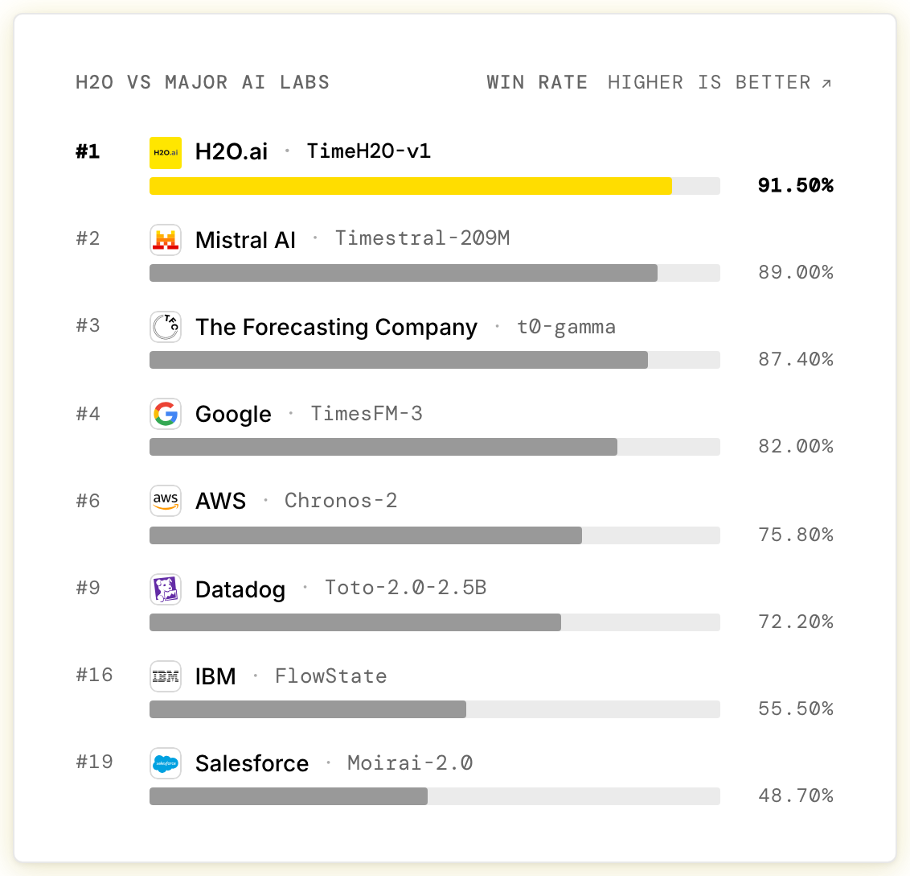
</picture>

| Rank | Company | Model | Win rate |
| ---: | --- | --- | ---: |
| **1** | **H2O.ai** | **TimeH2O-v1** | **91.50%** |
| 2 | Mistral AI | Timestral-209M | 89.00% |
| 3 | The Forecasting Company | t0-gamma | 87.40% |
| 4 | Google | TimesFM-3 | 82.00% |
| 6 | AWS | Chronos-2 | 75.80% |
| 9 | Datadog | Toto-2.0-2.5B | 72.20% |
| 16 | IBM | FlowState | 55.50% |
| 19 | Salesforce | Moirai-2.0 | 48.70% |

### #1 ImageJevBench

*Generative AI · Image decision models*

**H2O-Lightning-31B**

<table width="560">
<tr><td colspan="3" width="560">Image decision models answer typed questions about a picture and must return calibrated answers, scored on intelligence, calibration, speed and cost. An open-weights model.</td></tr>
<tr>
<td width="186" align="center" valign="top"><b><code>80.88</code></b> CAPABILITY SCORE</td>
<td width="186" align="center" valign="top"><b><code>0.59s</code></b> LATENCY INCL. NETWORK</td>
<td width="186" align="center" valign="top"><b><code>$0.075</code></b> PER 1,000 DECISIONS</td>
</tr>
<tr><td colspan="3" width="560"><a href="https://benchmarkheaven.com/image-jev-bench">Leaderboard</a> · <a href="https://benchmarkheaven.com/jev-models/methodology">How it scores</a> · <a href="https://huggingface.co/h2oai/h2o-lightning-31b">Model card</a></td></tr>
</table>

**Capability** · Higher is better

<picture>
  <source media="(prefers-color-scheme: dark)" srcset="readme/carousel-2-imagejevbench-dark.png">
  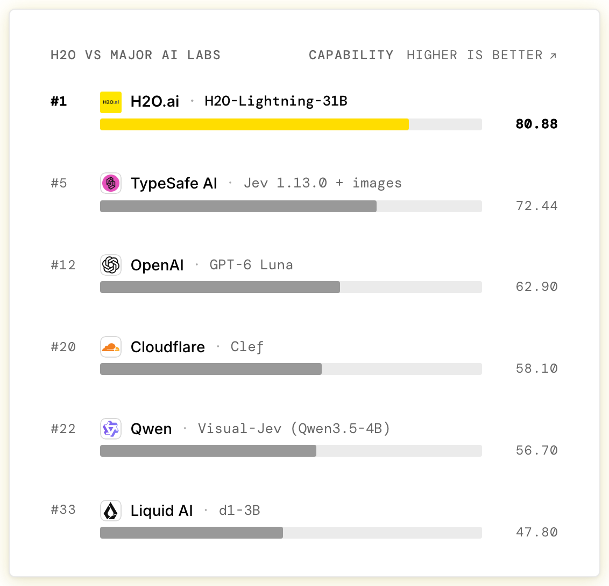
</picture>

| Rank | Company | Model | Capability |
| ---: | --- | --- | ---: |
| **1** | **H2O.ai** | **H2O-Lightning-31B** | **80.88** |
| 5 | TypeSafe AI | Jev 1.13.0 + images | 72.44 |
| 12 | OpenAI | GPT-6 Luna | 62.90 |
| 20 | Cloudflare | Clef | 58.10 |
| 22 | Qwen | Visual-Jev (Qwen3.5-4B) | 56.70 |
| 33 | Liquid AI | d1-3B | 47.80 |

### #4 JevBench

*Generative AI · Decision models*

**H2O-Lightning-31B**

<table width="560">
<tr><td colspan="3" width="560">Decision models get a situation and typed questions and must return calibrated answers, scored on intelligence, calibration, speed and cost. A 31B model with open weights.</td></tr>
<tr>
<td width="186" align="center" valign="top"><b><code>84.34</code></b> CAPABILITY SCORE</td>
<td width="186" align="center" valign="top"><b><code>0.28s</code></b> LATENCY INCL. NETWORK</td>
<td width="186" align="center" valign="top"><b><code>$0.029</code></b> PER 1,000 DECISIONS</td>
</tr>
<tr><td colspan="3" width="560"><a href="https://benchmarkheaven.com/jev-models">Leaderboard</a> · <a href="https://benchmarkheaven.com/jev-models/methodology">How it scores</a> · <a href="https://h2o.ai/blog/2026/h2o-lightning-jevbench">H2O blog post</a> · <a href="https://huggingface.co/h2oai/h2o-lightning-31b">Model card</a></td></tr>
</table>

**Capability** · Higher is better

<picture>
  <source media="(prefers-color-scheme: dark)" srcset="readme/carousel-3-jevbench-dark.png">
  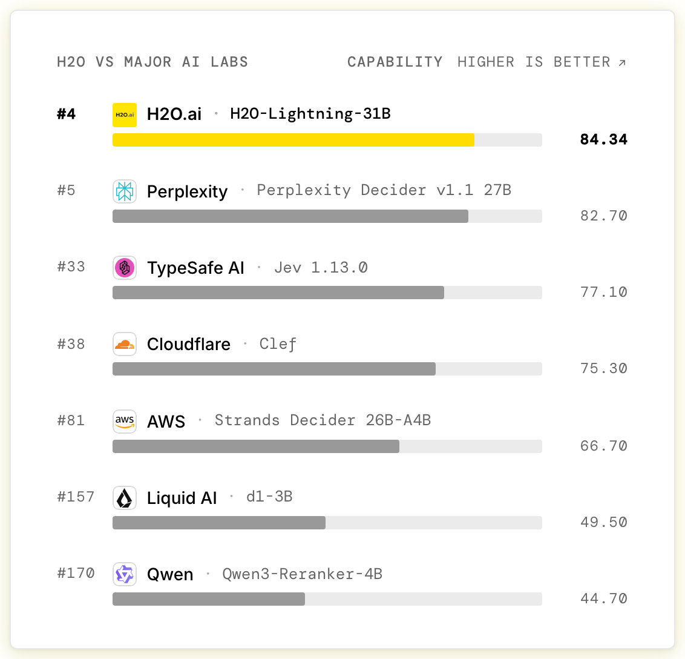
</picture>

| Rank | Company | Model | Capability |
| ---: | --- | --- | ---: |
| **4** | **H2O.ai** | **H2O-Lightning-31B** | **84.34** |
| 5 | Perplexity | Perplexity Decider v1.1 27B | 82.70 |
| 33 | TypeSafe AI | Jev 1.13.0 | 77.10 |
| 38 | Cloudflare | Clef | 75.30 |
| 81 | AWS | Strands Decider 26B-A4B | 66.70 |
| 157 | Liquid AI | d1-3B | 49.50 |
| 170 | Qwen | Qwen3-Reranker-4B | 44.70 |

### #1 FutureX

*Agentic AI · Future prediction*

**H2O AI Super Agent**

<table width="560">
<tr><td colspan="4" width="560">Agents predict real-world events before they resolve, with a new board every week, scored once the answers are known. H2O AI Super Agent has earned 26 FutureX medals (9 first places) across 45 weekly boards entered.</td></tr>
<tr>
<td width="140" align="center" valign="top"><b><code>#1</code></b> LATEST WEEKLY BOARD</td>
<td width="140" align="center" valign="top"><b><code>26</code></b> FUTUREX MEDALS</td>
<td width="140" align="center" valign="top"><b><code>9</code></b> FIRST PLACES</td>
<td width="140" align="center" valign="top"><b><code>19 / 45</code></b> BOARDS WITH A MEDAL</td>
</tr>
<tr><td colspan="4" width="560"><a href="https://futurex.live/">Leaderboard</a> · <a href="https://arxiv.org/abs/2508.11987">FutureX paper</a> · <a href="https://h2o.ai/products/h2ogpte">Enterprise h2oGPTe</a></td></tr>
</table>

**Overall score** · Higher is better

<picture>
  <source media="(prefers-color-scheme: dark)" srcset="readme/carousel-4-futurex-dark.png">
  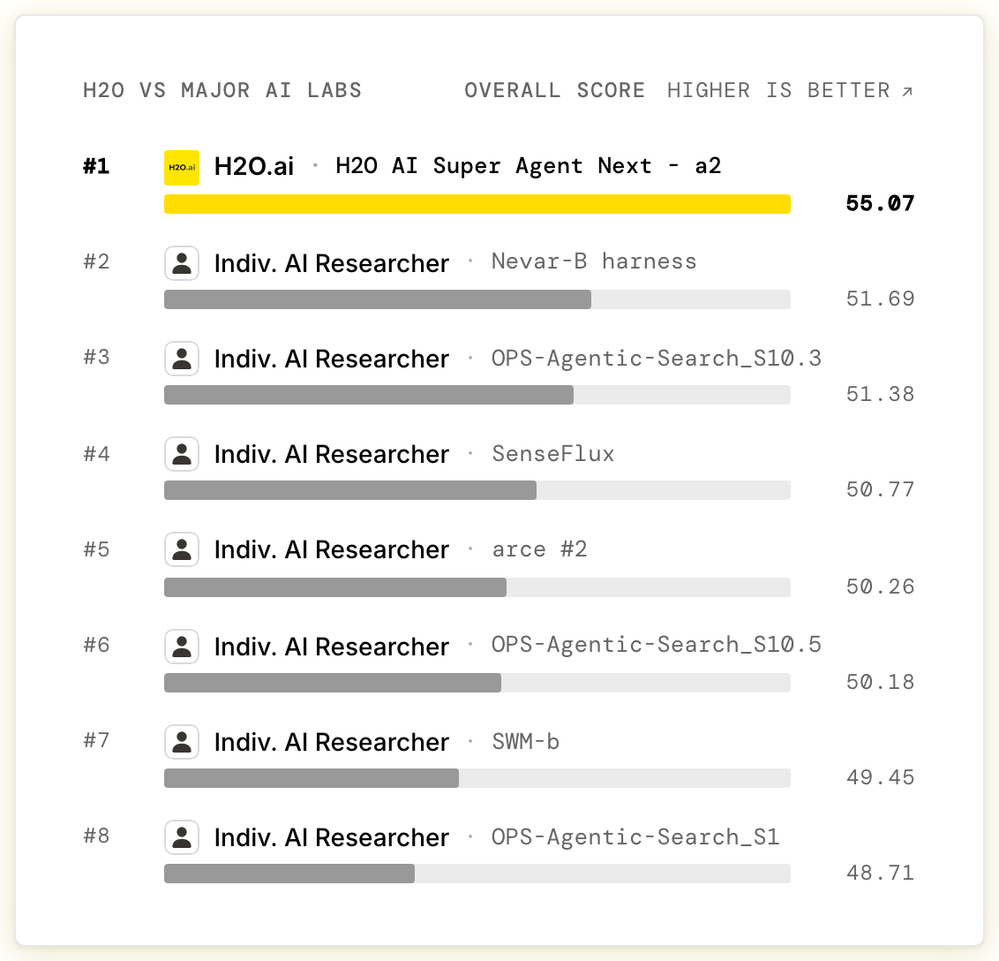
</picture>

| Rank | Company | Model | Overall score |
| ---: | --- | --- | ---: |
| **1** | **H2O.ai** | **H2O AI Super Agent Next - a2** | **55.07** |
| 2 | Indiv. AI Researcher | Nevar-B harness | 51.69 |
| 3 | Indiv. AI Researcher | OPS-Agentic-Search\_S10.3 | 51.38 |
| 4 | Indiv. AI Researcher | SenseFlux | 50.77 |
| 5 | Indiv. AI Researcher | arce #2 | 50.26 |
| 6 | Indiv. AI Researcher | OPS-Agentic-Search\_S10.5 | 50.18 |
| 7 | Indiv. AI Researcher | SWM-b | 49.45 |
| 8 | Indiv. AI Researcher | OPS-Agentic-Search\_S1 | 48.71 |

### #1 Social Simulation Arena

*Agentic AI · Social forecasting*

**H2O AI Super Agent** · **#3 H2O AI Marina**

<table width="560">
<tr><td colspan="3" width="560">Entrants forecast the next public release of poll, sentiment and attention series. Forecasts are locked before the answer exists and scored against the published number.</td></tr>
<tr>
<td width="186" align="center" valign="top"><b><code>70.74</code></b> PAIRWISE WIN RATE</td>
<td width="186" align="center" valign="top"><b><code>56</code></b> QUESTIONS ANSWERED</td>
<td width="186" align="center" valign="top"><b><code>+20.21</code></b> AHEAD OF ANTHROPIC</td>
</tr>
<tr><td colspan="3" width="560"><a href="https://social-simulation-arena.com/#leaderboard">Leaderboard</a> · <a href="https://h2o.ai/products/h2ogpte">Enterprise h2oGPTe</a> · <a href="https://h2oai.github.io/marina/">H2O AI Marina</a></td></tr>
</table>

**Pairwise win rate** · Higher is better

<picture>
  <source media="(prefers-color-scheme: dark)" srcset="readme/carousel-5-social-simulation-arena-dark.png">
  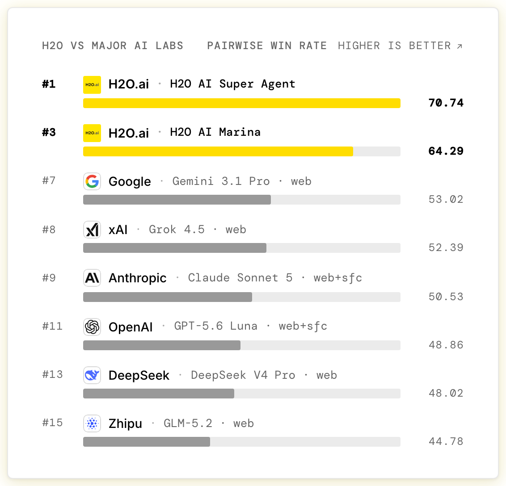
</picture>

| Rank | Company | Model | Pairwise win rate |
| ---: | --- | --- | ---: |
| **1** | **H2O.ai** | **H2O AI Super Agent** | **70.74** |
| **3** | **H2O.ai** | **H2O AI Marina** | **64.29** |
| 7 | Google | Gemini 3.1 Pro · web | 53.02 |
| 8 | xAI | Grok 4.5 · web | 52.39 |
| 9 | Anthropic | Claude Sonnet 5 · web+sfc | 50.53 |
| 11 | OpenAI | GPT-5.6 Luna · web+sfc | 48.86 |
| 13 | DeepSeek | DeepSeek V4 Pro · web | 48.02 |
| 15 | Zhipu | GLM-5.2 · web | 44.78 |

[↑ Back to top](#top)

## The benchmarks in detail

### #1 fev-bench

*Predictive AI · Time-series forecasting*

**TimeH2O-v1**

<table width="560">
<tr><td colspan="3" width="560">Zero-shot forecasting on real time series across many domains and frequencies, scored by probabilistic accuracy against a seasonal-naive baseline. 108.8M parameters.</td></tr>
<tr>
<td width="186" align="center" valign="top"><b><code>91.50%</code></b> WIN RATE</td>
<td width="186" align="center" valign="top"><b><code>50.80%</code></b> SKILL SCORE</td>
<td width="186" align="center" valign="top"><b><code>108.8M</code></b> PARAMETERS</td>
</tr>
<tr><td colspan="3" width="560"><a href="https://huggingface.co/spaces/autogluon/fev-bench">Leaderboard</a> · <a href="https://arxiv.org/abs/2509.26468">fev-bench paper</a> · <a href="https://huggingface.co/h2oai/timeh2o-v1">Model card</a></td></tr>
</table>

**Win rate · top 10** · Higher is better

<picture>
  <source media="(prefers-color-scheme: dark)" srcset="readme/fev-bench-dark.png">
  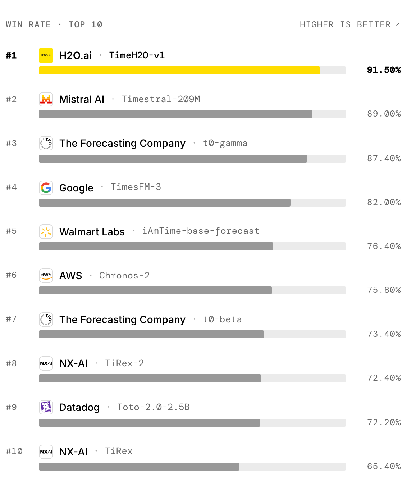
</picture>

| Rank | Company | Model | Score |
| ---: | --- | --- | ---: |
| **1** | **H2O.ai** | **TimeH2O-v1** | **91.50%** |
| 2 | Mistral AI | Timestral-209M | 89.00% |
| 3 | The Forecasting Company | t0-gamma | 87.40% |
| 4 | Google | TimesFM-3 | 82.00% |
| 5 | Walmart Labs | iAmTime-base-forecast | 76.40% |
| 6 | AWS | Chronos-2 | 75.80% |
| 7 | The Forecasting Company | t0-beta | 73.40% |
| 8 | NX-AI | TiRex-2 | 72.40% |
| 9 | Datadog | Toto-2.0-2.5B | 72.20% |
| 10 | NX-AI | TiRex | 65.40% |

[↑ Back to top](#top)

### #1 ImageJevBench

*Generative AI · Image decision models*

**H2O-Lightning-31B**

<table width="560">
<tr><td colspan="3" width="560">Image decision models answer typed questions about a picture and must return calibrated answers, scored on intelligence, calibration, speed and cost. An open-weights model.</td></tr>
<tr>
<td width="186" align="center" valign="top"><b><code>80.88</code></b> CAPABILITY SCORE</td>
<td width="186" align="center" valign="top"><b><code>0.59s</code></b> LATENCY INCL. NETWORK</td>
<td width="186" align="center" valign="top"><b><code>$0.075</code></b> PER 1,000 DECISIONS</td>
</tr>
<tr><td colspan="3" width="560"><a href="https://benchmarkheaven.com/image-jev-bench">Leaderboard</a> · <a href="https://benchmarkheaven.com/jev-models/methodology">How it scores</a> · <a href="https://huggingface.co/h2oai/h2o-lightning-31b">Model card</a></td></tr>
</table>

**Capability · top 10** · Higher is better

<picture>
  <source media="(prefers-color-scheme: dark)" srcset="readme/imagejevbench-capability-dark.png">
  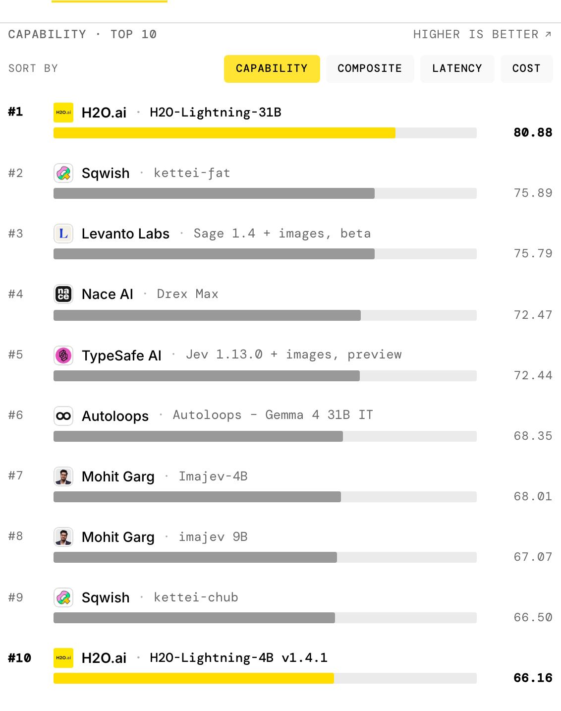
</picture>

| Rank | Company | Model | Capability |
| ---: | --- | --- | ---: |
| **1** | **H2O.ai** | **H2O-Lightning-31B** | **80.88** |
| 2 | Sqwish | kettei-fat | 75.89 |
| 3 | Levanto Labs | Sage 1.4 + images, beta | 75.79 |
| 4 | Nace AI | Drex Max | 72.47 |
| 5 | TypeSafe AI | Jev 1.13.0 + images, preview | 72.44 |
| 6 | Autoloops | Autoloops – Gemma 4 31B IT | 68.35 |
| 7 | Mohit Garg | Imajev-4B | 68.01 |
| 8 | Mohit Garg | imajev 9B | 67.07 |
| 9 | Sqwish | kettei-chub | 66.50 |
| **10** | **H2O.ai** | **H2O-Lightning-4B v1.4.1** | **66.16** |

<b>Composite · top 10</b> · Higher is better

<picture>
  <source media="(prefers-color-scheme: dark)" srcset="readme/imagejevbench-composite-dark.png">
  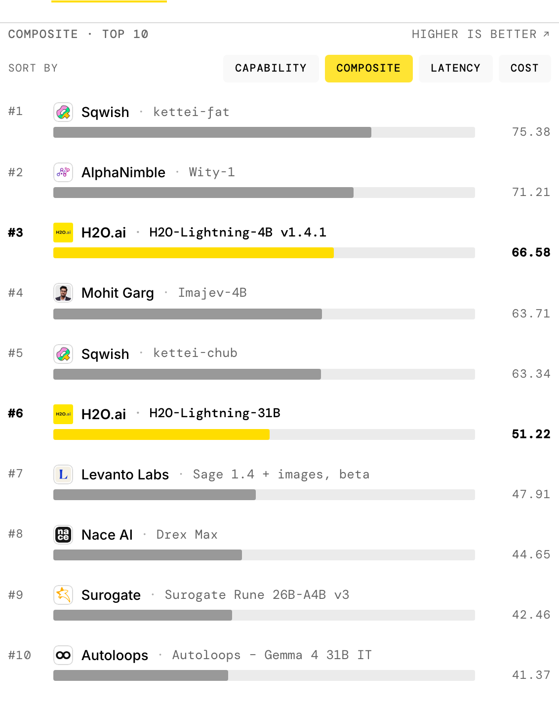
</picture>

| Rank | Company | Model | Composite |
| ---: | --- | --- | ---: |
| 1 | Sqwish | kettei-fat | 75.38 |
| 2 | AlphaNimble | Wity-1 | 71.21 |
| **3** | **H2O.ai** | **H2O-Lightning-4B v1.4.1** | **66.58** |
| 4 | Mohit Garg | Imajev-4B | 63.71 |
| 5 | Sqwish | kettei-chub | 63.34 |
| **6** | **H2O.ai** | **H2O-Lightning-31B** | **51.22** |
| 7 | Levanto Labs | Sage 1.4 + images, beta | 47.91 |
| 8 | Nace AI | Drex Max | 44.65 |
| 9 | Surogate | Surogate Rune 26B-A4B v3 | 42.46 |
| 10 | Autoloops | Autoloops – Gemma 4 31B IT | 41.37 |

<b>Latency · composite top 10</b> · Lower is better

<picture>
  <source media="(prefers-color-scheme: dark)" srcset="readme/imagejevbench-latency-dark.png">
  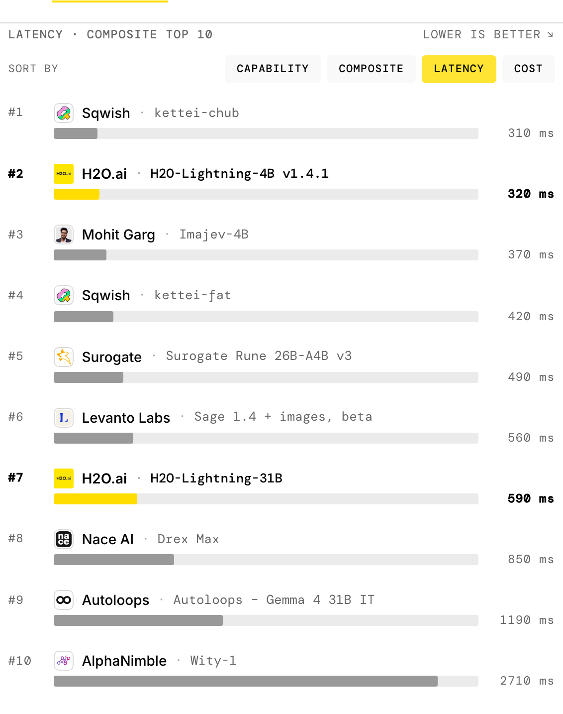
</picture>

| Rank | Company | Model | Latency |
| ---: | --- | --- | ---: |
| 1 | Sqwish | kettei-chub | 310 ms |
| **2** | **H2O.ai** | **H2O-Lightning-4B v1.4.1** | **320 ms** |
| 3 | Mohit Garg | Imajev-4B | 370 ms |
| 4 | Sqwish | kettei-fat | 420 ms |
| 5 | Surogate | Surogate Rune 26B-A4B v3 | 490 ms |
| 6 | Levanto Labs | Sage 1.4 + images, beta | 560 ms |
| **7** | **H2O.ai** | **H2O-Lightning-31B** | **590 ms** |
| 8 | Nace AI | Drex Max | 850 ms |
| 9 | Autoloops | Autoloops – Gemma 4 31B IT | 1190 ms |
| 10 | AlphaNimble | Wity-1 | 2710 ms |

<b>Cost · composite top 10</b> · Lower is better

<picture>
  <source media="(prefers-color-scheme: dark)" srcset="readme/imagejevbench-cost-dark.png">
  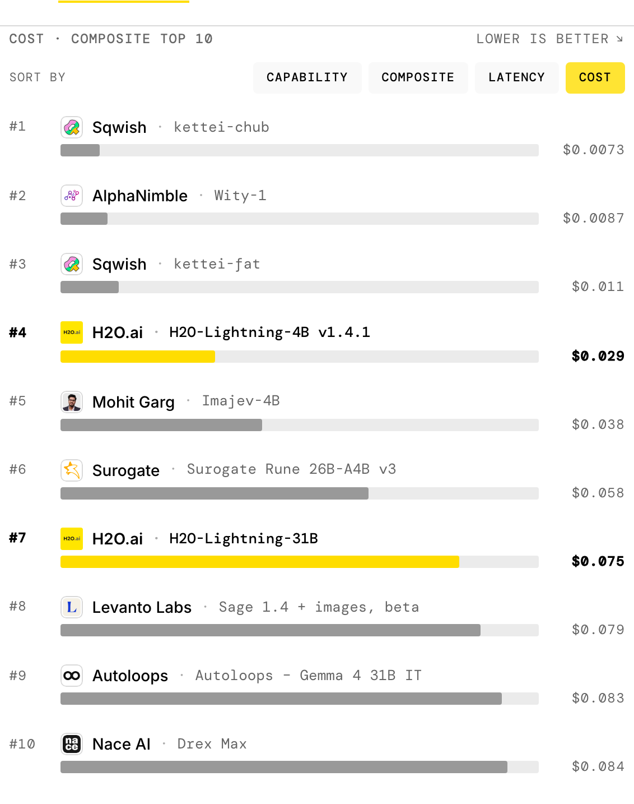
</picture>

| Rank | Company | Model | Cost |
| ---: | --- | --- | ---: |
| 1 | Sqwish | kettei-chub | \$0.0073 |
| 2 | AlphaNimble | Wity-1 | \$0.0087 |
| 3 | Sqwish | kettei-fat | \$0.011 |
| **4** | **H2O.ai** | **H2O-Lightning-4B v1.4.1** | **\$0.029** |
| 5 | Mohit Garg | Imajev-4B | \$0.038 |
| 6 | Surogate | Surogate Rune 26B-A4B v3 | \$0.058 |
| **7** | **H2O.ai** | **H2O-Lightning-31B** | **\$0.075** |
| 8 | Levanto Labs | Sage 1.4 + images, beta | \$0.079 |
| 9 | Autoloops | Autoloops – Gemma 4 31B IT | \$0.083 |
| 10 | Nace AI | Drex Max | \$0.084 |

[↑ Back to top](#top)

### #4 JevBench

*Generative AI · Decision models*

**H2O-Lightning-31B**

<table width="560">
<tr><td colspan="3" width="560">Decision models get a situation and typed questions and must return calibrated answers, scored on intelligence, calibration, speed and cost. A 31B model with open weights.</td></tr>
<tr>
<td width="186" align="center" valign="top"><b><code>84.34</code></b> CAPABILITY SCORE</td>
<td width="186" align="center" valign="top"><b><code>0.28s</code></b> LATENCY INCL. NETWORK</td>
<td width="186" align="center" valign="top"><b><code>$0.029</code></b> PER 1,000 DECISIONS</td>
</tr>
<tr><td colspan="3" width="560"><a href="https://benchmarkheaven.com/jev-models">Leaderboard</a> · <a href="https://benchmarkheaven.com/jev-models/methodology">How it scores</a> · <a href="https://h2o.ai/blog/2026/h2o-lightning-jevbench">H2O blog post</a> · <a href="https://huggingface.co/h2oai/h2o-lightning-31b">Model card</a></td></tr>
</table>

**Capability · top 10** · Higher is better

<picture>
  <source media="(prefers-color-scheme: dark)" srcset="readme/jevbench-capability-dark.png">
  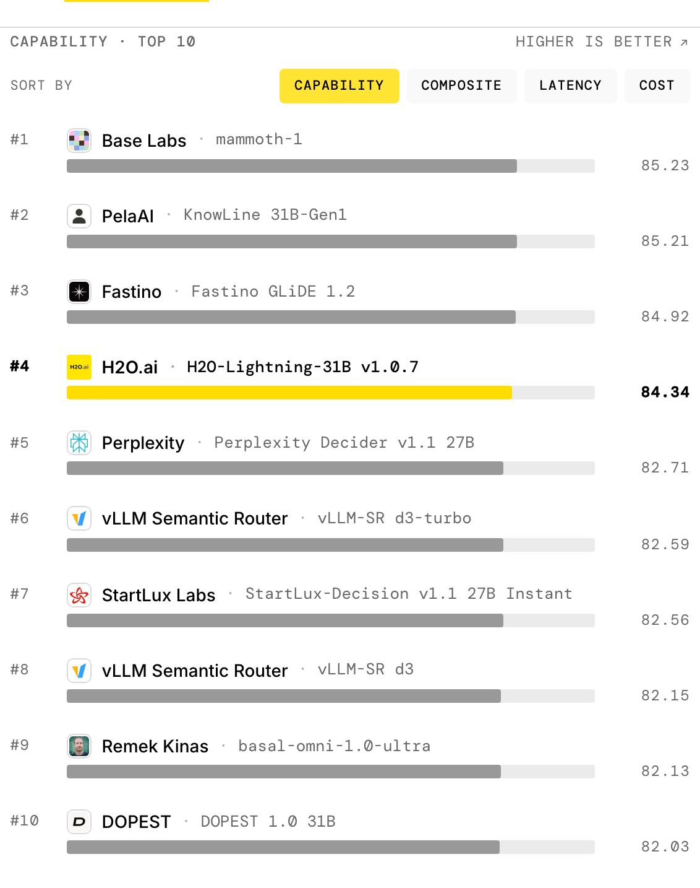
</picture>

| Rank | Company | Model | Capability |
| ---: | --- | --- | ---: |
| 1 | Base Labs | mammoth-1 | 85.23 |
| 2 | PelaAI | KnowLine 31B-Gen1 | 85.21 |
| 3 | Fastino | Fastino GLiDE 1.2 | 84.92 |
| **4** | **H2O.ai** | **H2O-Lightning-31B v1.0.7** | **84.34** |
| 5 | Perplexity | Perplexity Decider v1.1 27B | 82.71 |
| 6 | vLLM Semantic Router | vLLM-SR d3-turbo | 82.59 |
| 7 | StartLux Labs | StartLux-Decision v1.1 27B Instant | 82.56 |
| 8 | vLLM Semantic Router | vLLM-SR d3 | 82.15 |
| 9 | Remek Kinas | basal-omni-1.0-ultra | 82.13 |
| 10 | DOPEST | DOPEST 1.0 31B | 82.03 |

<b>Composite · top 10</b> · Higher is better

<picture>
  <source media="(prefers-color-scheme: dark)" srcset="readme/jevbench-composite-dark.png">
  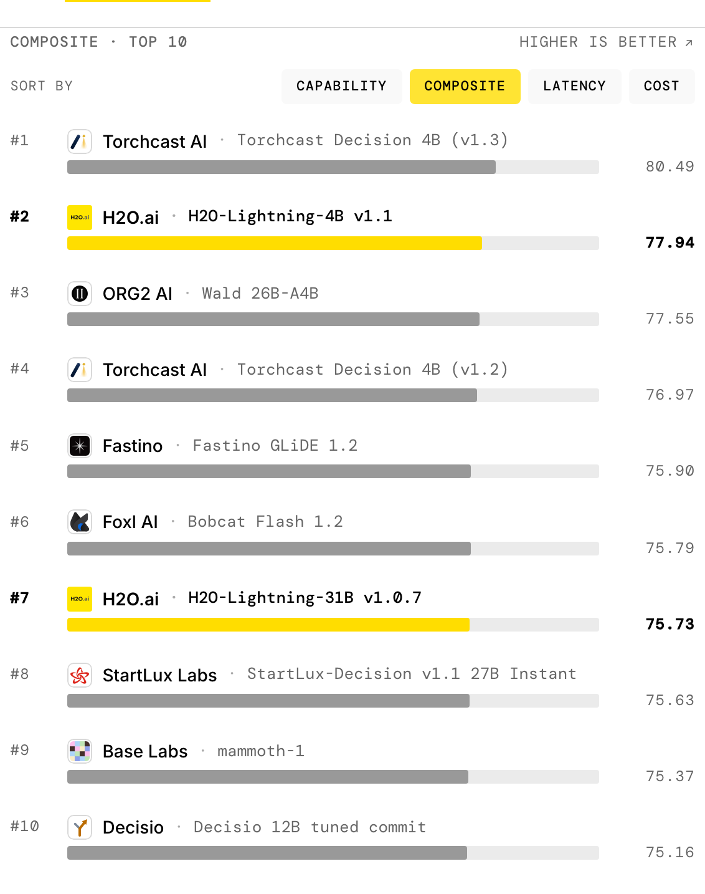
</picture>

| Rank | Company | Model | Composite |
| ---: | --- | --- | ---: |
| 1 | Torchcast AI | Torchcast Decision 4B (v1.3) | 80.49 |
| **2** | **H2O.ai** | **H2O-Lightning-4B v1.1** | **77.94** |
| 3 | ORG2 AI | Wald 26B-A4B | 77.55 |
| 4 | Torchcast AI | Torchcast Decision 4B (v1.2) | 76.97 |
| 5 | Fastino | Fastino GLiDE 1.2 | 75.90 |
| 6 | Foxl AI | Bobcat Flash 1.2 | 75.79 |
| **7** | **H2O.ai** | **H2O-Lightning-31B v1.0.7** | **75.73** |
| 8 | StartLux Labs | StartLux-Decision v1.1 27B Instant | 75.63 |
| 9 | Base Labs | mammoth-1 | 75.37 |
| 10 | Decisio | Decisio 12B tuned commit | 75.16 |

<b>Latency · composite top 10</b> · Lower is better

<picture>
  <source media="(prefers-color-scheme: dark)" srcset="readme/jevbench-latency-dark.png">
  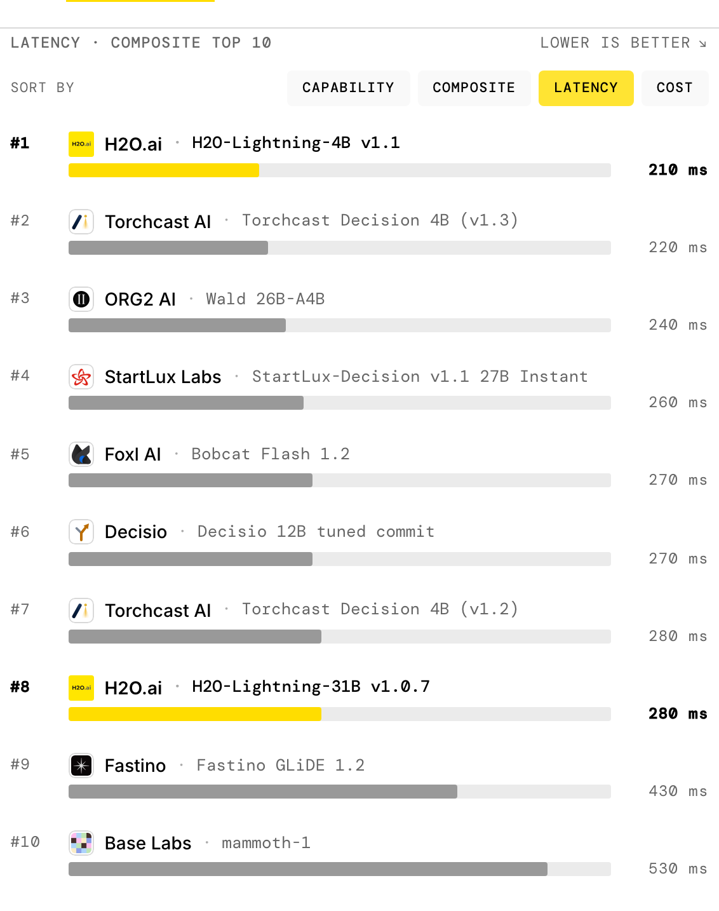
</picture>

| Rank | Company | Model | Latency |
| ---: | --- | --- | ---: |
| **1** | **H2O.ai** | **H2O-Lightning-4B v1.1** | **210 ms** |
| 2 | Torchcast AI | Torchcast Decision 4B (v1.3) | 220 ms |
| 3 | ORG2 AI | Wald 26B-A4B | 240 ms |
| 4 | StartLux Labs | StartLux-Decision v1.1 27B Instant | 260 ms |
| 5 | Foxl AI | Bobcat Flash 1.2 | 270 ms |
| 6 | Decisio | Decisio 12B tuned commit | 270 ms |
| 7 | Torchcast AI | Torchcast Decision 4B (v1.2) | 280 ms |
| **8** | **H2O.ai** | **H2O-Lightning-31B v1.0.7** | **280 ms** |
| 9 | Fastino | Fastino GLiDE 1.2 | 430 ms |
| 10 | Base Labs | mammoth-1 | 530 ms |

<b>Cost · composite top 10</b> · Lower is better

<picture>
  <source media="(prefers-color-scheme: dark)" srcset="readme/jevbench-cost-dark.png">
  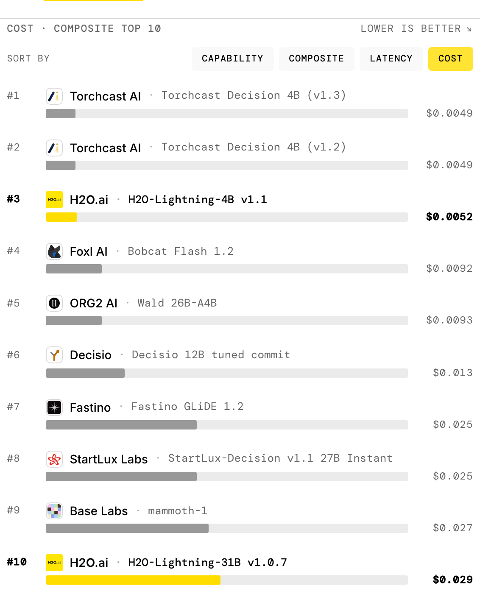
</picture>

| Rank | Company | Model | Cost |
| ---: | --- | --- | ---: |
| 1 | Torchcast AI | Torchcast Decision 4B (v1.3) | \$0.0049 |
| 2 | Torchcast AI | Torchcast Decision 4B (v1.2) | \$0.0049 |
| **3** | **H2O.ai** | **H2O-Lightning-4B v1.1** | **\$0.0052** |
| 4 | Foxl AI | Bobcat Flash 1.2 | \$0.0092 |
| 5 | ORG2 AI | Wald 26B-A4B | \$0.0093 |
| 6 | Decisio | Decisio 12B tuned commit | \$0.013 |
| 7 | Fastino | Fastino GLiDE 1.2 | \$0.025 |
| 8 | StartLux Labs | StartLux-Decision v1.1 27B Instant | \$0.025 |
| 9 | Base Labs | mammoth-1 | \$0.027 |
| **10** | **H2O.ai** | **H2O-Lightning-31B v1.0.7** | **\$0.029** |

[↑ Back to top](#top)

### #5 TALENT

*Predictive AI · Tabular foundation models*

**TabH2O v1.1**

<table width="560">
<tr><td colspan="4" width="560">Two public benchmark suites of tabular classification and regression datasets, comparing tabular foundation models, AutoML, and tuned gradient boosting across 300 datasets on TALENT and 51 datasets on TabArena.</td></tr>
<tr>
<td width="140" align="center" valign="top"><b><code>#5 / 13</code></b> TALENT RANK</td>
<td width="140" align="center" valign="top"><b><code>300</code></b> TALENT DATASETS</td>
<td width="140" align="center" valign="top"><b><code>#7 / 39</code></b> TABARENA RANK</td>
<td width="140" align="center" valign="top"><b><code>51</code></b> TABARENA DATASETS</td>
</tr>
<tr><td colspan="4" width="560"><a href="https://github.com/LAMDA-Tabular/TALENT">TALENT</a> · <a href="https://tabarena.ai">TabArena</a> · <a href="https://h2o.ai/blog/2026/h2oai-unveils-tabh2o-at-dell-technologies-world-2026">Introducing TabH2O</a> · <a href="https://arxiv.org/abs/2605.18383">TabH2O paper</a> · <a href="https://h2o.ai/products/tabh2o">TabH2O</a></td></tr>
</table>

**TALENT · average rank across datasets · top 10** · Lower is better

<picture>
  <source media="(prefers-color-scheme: dark)" srcset="readme/tabh2o-talent-dark.png">
  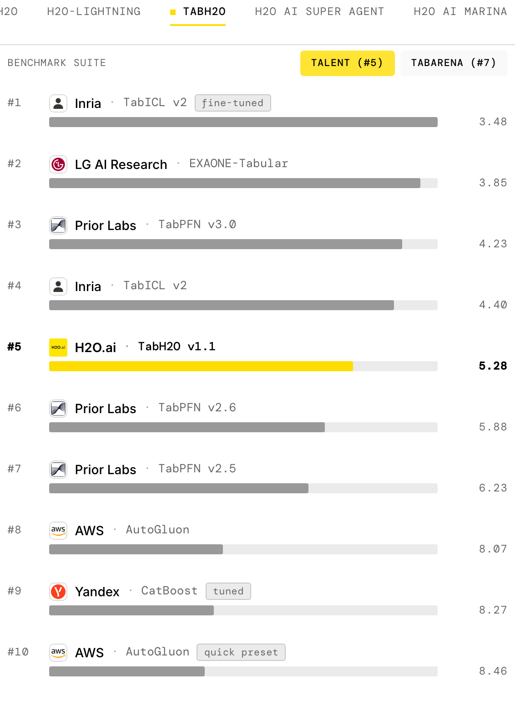
</picture>

| Rank | Company | Model | Average rank |
| ---: | --- | --- | ---: |
| 1 | Inria | TabICL v2 (fine-tuned) | 3.48 |
| 2 | LG AI Research | EXAONE-Tabular | 3.85 |
| 3 | Prior Labs | TabPFN v3.0 | 4.23 |
| 4 | Inria | TabICL v2 | 4.40 |
| **5** | **H2O.ai** | **TabH2O v1.1** | **5.28** |
| 6 | Prior Labs | TabPFN v2.6 | 5.88 |
| 7 | Prior Labs | TabPFN v2.5 | 6.23 |
| 8 | AWS | AutoGluon | 8.07 |
| 9 | Yandex | CatBoost (tuned) | 8.27 |
| 10 | AWS | AutoGluon (quick preset) | 8.46 |

<b>TabArena · average rank across datasets · top 10</b> · Lower is better

<picture>
  <source media="(prefers-color-scheme: dark)" srcset="readme/tabh2o-tabarena-dark.png">
  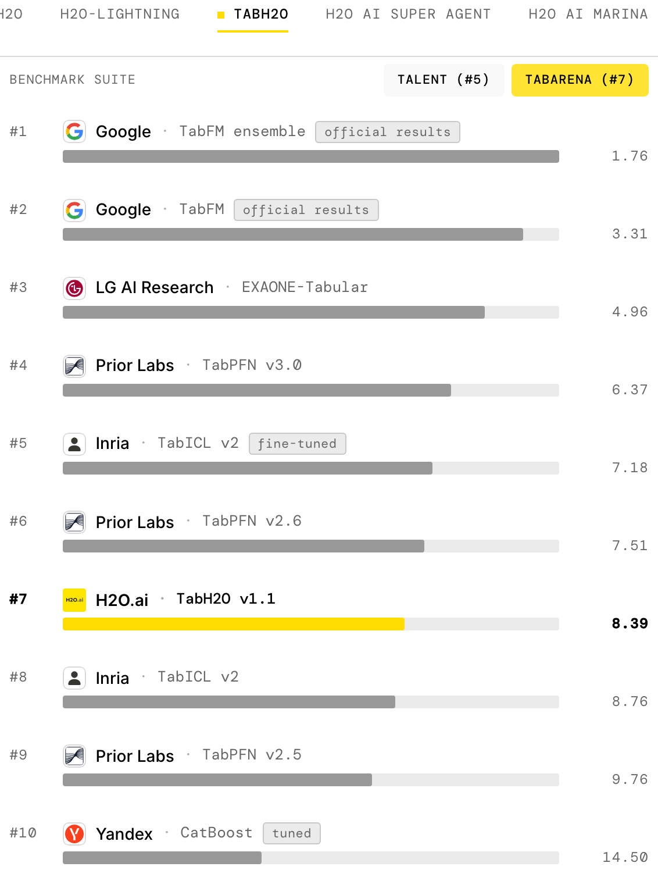
</picture>

| Rank | Company | Model | Average rank |
| ---: | --- | --- | ---: |
| 1 | Google | TabFM ensemble (official results) | 1.76 |
| 2 | Google | TabFM (official results) | 3.31 |
| 3 | LG AI Research | EXAONE-Tabular | 4.96 |
| 4 | Prior Labs | TabPFN v3.0 | 6.37 |
| 5 | Inria | TabICL v2 (fine-tuned) | 7.18 |
| 6 | Prior Labs | TabPFN v2.6 | 7.51 |
| **7** | **H2O.ai** | **TabH2O v1.1** | **8.39** |
| 8 | Inria | TabICL v2 | 8.76 |
| 9 | Prior Labs | TabPFN v2.5 | 9.76 |
| 10 | Yandex | CatBoost (tuned) | 14.50 |

[↑ Back to top](#top)

### #1 FutureX

*Agentic AI · Future prediction*

**H2O AI Super Agent**

<table width="560">
<tr><td colspan="4" width="560">Agents predict real-world events before they resolve, with a new board every week, scored once the answers are known. H2O AI Super Agent has earned 26 FutureX medals (9 first places) across 45 weekly boards entered.</td></tr>
<tr>
<td width="140" align="center" valign="top"><b><code>#1</code></b> LATEST WEEKLY BOARD</td>
<td width="140" align="center" valign="top"><b><code>26</code></b> FUTUREX MEDALS</td>
<td width="140" align="center" valign="top"><b><code>9</code></b> FIRST PLACES</td>
<td width="140" align="center" valign="top"><b><code>19 / 45</code></b> BOARDS WITH A MEDAL</td>
</tr>
<tr><td colspan="4" width="560"><a href="https://futurex.live/">Leaderboard</a> · <a href="https://arxiv.org/abs/2508.11987">FutureX paper</a> · <a href="https://h2o.ai/products/h2ogpte">Enterprise h2oGPTe</a></td></tr>
</table>

**Overall score, weekly board · top 10** · Higher is better

<picture>
  <source media="(prefers-color-scheme: dark)" srcset="readme/futurex-dark.png">
  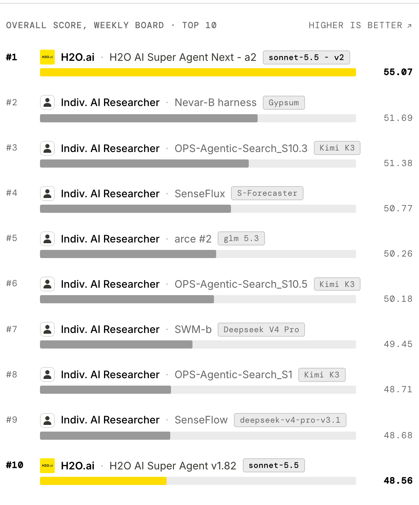
</picture>

| Rank | Company | Framework | Base model | Score |
| ---: | --- | --- | --- | ---: |
| **1** | **H2O.ai** | **H2O AI Super Agent Next - a2** | **sonnet-5.5 - v2** | **55.07** |
| 2 | Indiv. AI Researcher | Nevar-B harness | Gypsum | 51.69 |
| 3 | Indiv. AI Researcher | OPS-Agentic-Search\_S10.3 | Kimi K3 | 51.38 |
| 4 | Indiv. AI Researcher | SenseFlux | S-Forecaster | 50.77 |
| 5 | Indiv. AI Researcher | arce #2 | glm 5.3 | 50.26 |
| 6 | Indiv. AI Researcher | OPS-Agentic-Search\_S10.5 | Kimi K3 | 50.18 |
| 7 | Indiv. AI Researcher | SWM-b | Deepseek V4 Pro | 49.45 |
| 8 | Indiv. AI Researcher | OPS-Agentic-Search\_S1 | Kimi K3 | 48.71 |
| 9 | Indiv. AI Researcher | SenseFlow | deepseek-v4-pro-v3.1 | 48.68 |
| **10** | **H2O.ai** | **H2O AI Super Agent v1.82** | **sonnet-5.5** | **48.56** |

[↑ Back to top](#top)

### #1 Social Simulation Arena

*Agentic AI · Social forecasting*

**H2O AI Super Agent** · **#3 H2O AI Marina**

<table width="560">
<tr><td colspan="3" width="560">Entrants forecast the next public release of poll, sentiment and attention series. Forecasts are locked before the answer exists and scored against the published number.</td></tr>
<tr>
<td width="186" align="center" valign="top"><b><code>70.74</code></b> PAIRWISE WIN RATE</td>
<td width="186" align="center" valign="top"><b><code>56</code></b> QUESTIONS ANSWERED</td>
<td width="186" align="center" valign="top"><b><code>+20.21</code></b> AHEAD OF ANTHROPIC</td>
</tr>
<tr><td colspan="3" width="560"><a href="https://social-simulation-arena.com/#leaderboard">Leaderboard</a> · <a href="https://h2o.ai/products/h2ogpte">Enterprise h2oGPTe</a> · <a href="https://h2oai.github.io/marina/">H2O AI Marina</a></td></tr>
</table>

**Pairwise win rate · top 10** · Higher is better

<picture>
  <source media="(prefers-color-scheme: dark)" srcset="readme/social-simulation-arena-dark.png">
  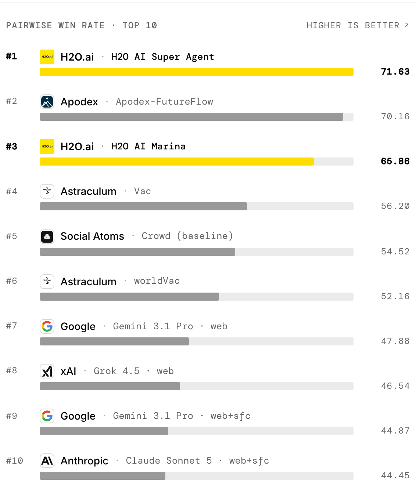
</picture>

| Rank | Company | Model | Score |
| ---: | --- | --- | ---: |
| **1** | **H2O.ai** | **H2O AI Super Agent** | **70.74** |
| 2 | Apodex | Apodex-FutureFlow | 69.56 |
| **3** | **H2O.ai** | **H2O AI Marina** | **64.29** |
| 4 | Astraculum | Vac | 61.55 |
| 5 | Social Atoms | Crowd (baseline) | 55.92 |
| 6 | Astraculum | worldVac | 54.28 |
| 7 | Google | Gemini 3.1 Pro · web | 53.02 |
| 8 | xAI | Grok 4.5 · web | 52.39 |
| 9 | Anthropic | Claude Sonnet 5 · web+sfc | 50.53 |
| 10 | Google | Gemini 3.1 Pro · web+sfc | 49.85 |

[↑ Back to top](#top)

---

[Download all data (CSV)](site/data/h2o-benchmarks.csv)
<!-- benchmarks:end -->
