<!-- benchmarks:begin -->
<!-- Generated from the benchmark data; do not edit by hand. -->

<h1>Leading AI in  Predictive, Generative, and Agentic AI.</h1>

Benchmark data read on November 24, 2026.

[Overview](#overview-cards) · [Featured](#featured) · [fev-bench](#fev-bench) · [EnergyBench by Foretec](#energybench) · [ImageJevBench](#imagejevbench) · [ImageJevBench Box Track](#imagejevbench-box-track) · [JevBench](#jevbench) · [TabH2O](#tabh2o) · [FutureX](#futurex) · [Social Simulation Arena](#social-simulation-arena)

## Overview

<picture>
  <source media="(prefers-color-scheme: dark)" srcset="readme/carousel-8-overview-dark.png">
  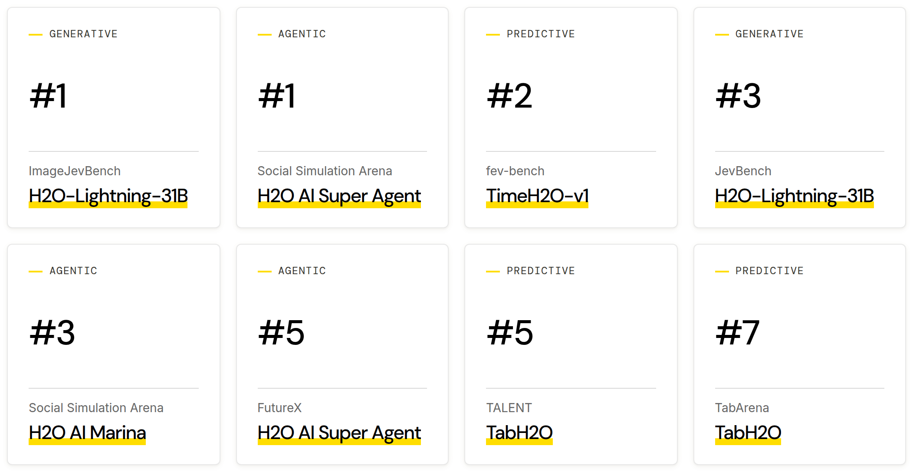
</picture>

| Category | Rank | Benchmark | Model |
| --- | --- | --- | --- |
| Generative | #1 | ImageJevBench | H2O-Lightning-31B |
| Agentic | #1 | Social Simulation Arena | H2O AI Super Agent |
| Predictive | #2 | fev-bench | TimeH2O-v1 |
| Generative | #3 | JevBench | H2O-Lightning-31B |
| Agentic | #3 | Social Simulation Arena | H2O AI Marina |
| Agentic | #5 | FutureX | H2O AI Super Agent |
| Predictive | #5 | TALENT | TabH2O |
| Predictive | #7 | TabArena | TabH2O |

## H2O vs Major AI Labs

### #1 ImageJevBench

*Generative AI · Image decision models*

**H2O-Lightning-31B**

<table width="560">
<tr><td colspan="3" width="560">Image decision models answer typed questions about a picture and must return calibrated answers, scored on intelligence, calibration, speed and cost. An open-weights model.</td></tr>
<tr>
<td width="186" align="center" valign="top"><b><code>80.88</code></b> CAPABILITY SCORE</td>
<td width="186" align="center" valign="top"><b><code>0.59s</code></b> LATENCY INCL. NETWORK</td>
<td width="186" align="center" valign="top"><b><code>$0.075</code></b> PER 1,000 DECISIONS</td>
</tr>
<tr><td colspan="3" width="560"><a href="https://benchmarkheaven.com/image-jev-bench">Leaderboard</a> · <a href="https://benchmarkheaven.com/jev-models/methodology">How it scores</a> · <a href="https://huggingface.co/h2oai/h2o-lightning-31b">Model card</a></td></tr>
</table>

**Capability** · Higher is better

<picture>
  <source media="(prefers-color-scheme: dark)" srcset="readme/carousel-1-imagejevbench-dark.png">
  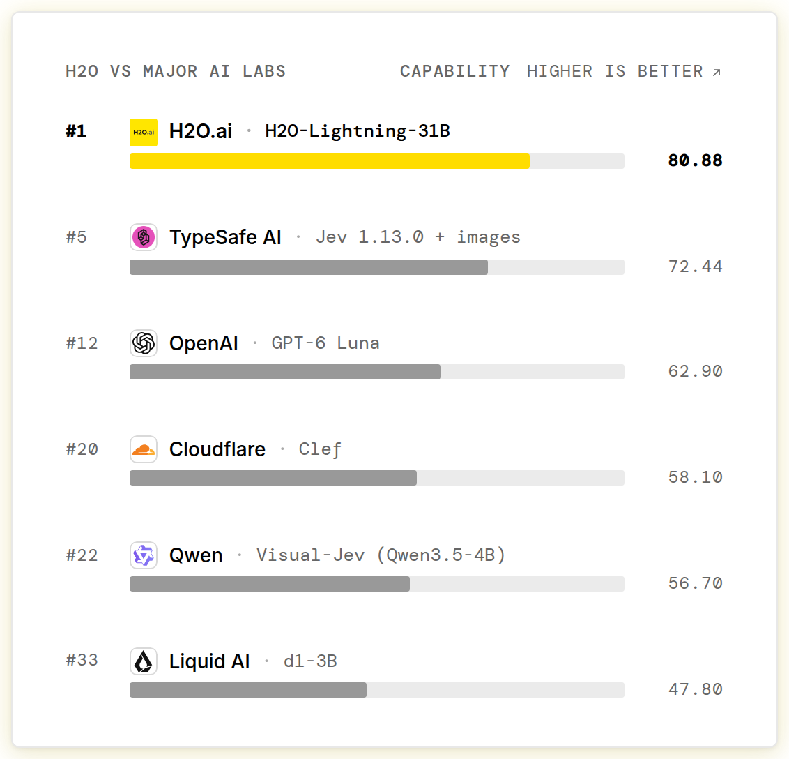
</picture>

| Rank | Company | Model | Capability |
| ---: | --- | --- | ---: |
| **1** | **H2O.ai** | **H2O-Lightning-31B** | **80.88** |
| 6 | TypeSafe AI | Jev 1.13.0 + images | 72.44 |
| 13 | OpenAI | GPT-6 Luna | 62.90 |
| 21 | Cloudflare | Clef | 58.10 |
| 23 | Qwen | Visual-Jev (Qwen3.5-4B) | 56.70 |
| 34 | Liquid AI | d1-3B | 47.80 |

### #1 EnergyBench by Foretec

*Predictive AI · Energy forecasting*

**TimeH2O-v1**

<table width="560">
<tr><td colspan="3" width="560">Day-ahead electricity forecasting in six European zones, scored every day against the grid operators&#x27; own figures. Ranked by Elo on the board&#x27;s default view (all zones, all four targets) over 53 live days to November 24. Data and scores: CC BY 4.0.</td></tr>
<tr>
<td width="186" align="center" valign="top"><b><code>1195</code></b> ELO</td>
<td width="186" align="center" valign="top"><b><code>74.10%</code></b> WIN RATE</td>
<td width="186" align="center" valign="top"><b><code>66.60%</code></b> SKILL SCORE</td>
</tr>
<tr><td colspan="3" width="560"><a href="https://energybench.foretec.co/">Leaderboard</a> · <a href="https://energybench.foretec.co/methodology.html">How it scores</a> · <a href="https://huggingface.co/h2oai/timeh2o-v1">Model card</a> · <a href="https://creativecommons.org/licenses/by/4.0/">CC BY 4.0</a></td></tr>
</table>

**Elo** · Higher is better

<picture>
  <source media="(prefers-color-scheme: dark)" srcset="readme/carousel-2-energybench-dark.png">
  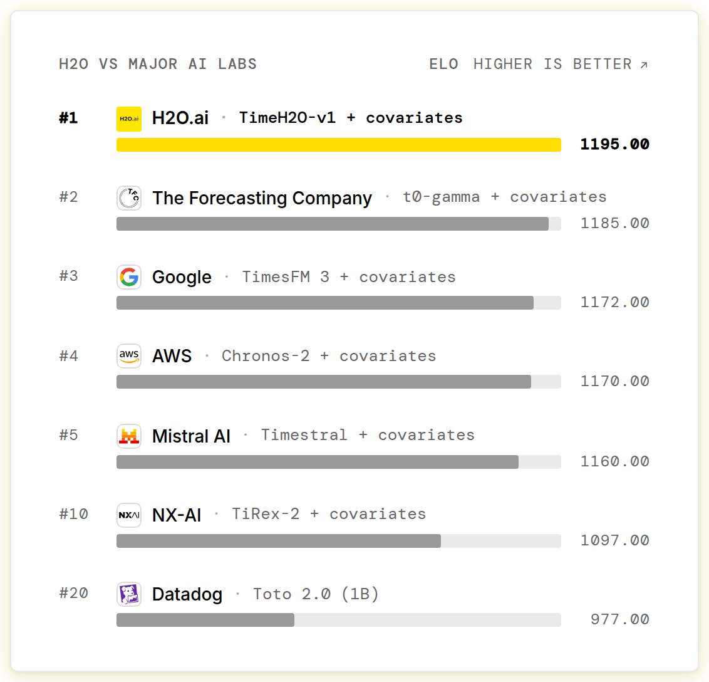
</picture>

| Rank | Company | Model | Elo |
| ---: | --- | --- | ---: |
| **1** | **H2O.ai** | **TimeH2O-v1 + covariates** | **1195.00** |
| 2 | The Forecasting Company | t0-gamma + covariates | 1185.00 |
| 3 | Google | TimesFM 3 + covariates | 1172.00 |
| 4 | AWS | Chronos-2 + covariates | 1170.00 |
| 5 | Mistral AI | Timestral + covariates | 1160.00 |
| 10 | NX-AI | TiRex-2 + covariates | 1097.00 |
| 20 | Datadog | Toto 2.0 (1B) | 977.00 |

### #1 Social Simulation Arena

*Agentic AI · Social forecasting*

**H2O AI Super Agent** · **#3 H2O AI Marina**

<table width="560">
<tr><td colspan="3" width="560">Entrants forecast the next public release of poll, sentiment and attention series. Forecasts are locked before the answer exists and scored against the published number.</td></tr>
<tr>
<td width="186" align="center" valign="top"><b><code>68.59</code></b> PAIRWISE WIN RATE</td>
<td width="186" align="center" valign="top"><b><code>85</code></b> QUESTIONS ANSWERED</td>
<td width="186" align="center" valign="top"><b><code>+28.55</code></b> AHEAD OF ANTHROPIC</td>
</tr>
<tr><td colspan="3" width="560"><a href="https://social-simulation-arena.com/#leaderboard">Leaderboard</a> · <a href="https://h2o.ai/products/h2ogpte">Enterprise h2oGPTe</a> · <a href="https://h2oai.github.io/marina/">H2O AI Marina</a></td></tr>
</table>

**Pairwise win rate** · Higher is better

<picture>
  <source media="(prefers-color-scheme: dark)" srcset="readme/carousel-3-social-simulation-arena-dark.png">
  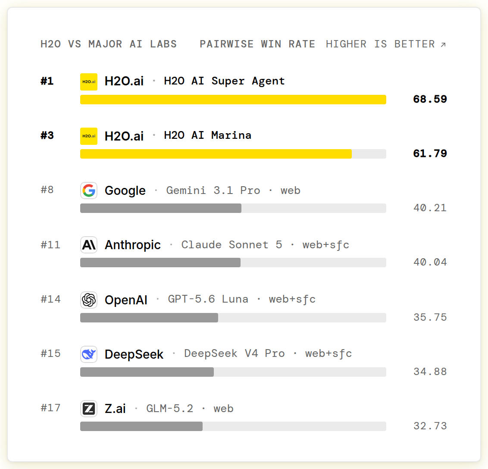
</picture>

| Rank | Company | Model | Pairwise win rate |
| ---: | --- | --- | ---: |
| **1** | **H2O.ai** | **H2O AI Super Agent** | **68.59** |
| **3** | **H2O.ai** | **H2O AI Marina** | **61.79** |
| 8 | Google | Gemini 3.1 Pro · web | 40.21 |
| 11 | Anthropic | Claude Sonnet 5 · web+sfc | 40.04 |
| 14 | OpenAI | GPT-5.6 Luna · web+sfc | 35.75 |
| 15 | DeepSeek | DeepSeek V4 Pro · web+sfc | 34.88 |
| 17 | Z.ai | GLM-5.2 · web | 32.73 |

### #2 fev-bench

*Predictive AI · Time-series forecasting*

**TimeH2O-v1**

<table width="560">
<tr><td colspan="3" width="560">Zero-shot forecasting on real time series across many domains and frequencies, scored by probabilistic accuracy against a seasonal-naive baseline. 108.8M parameters.</td></tr>
<tr>
<td width="186" align="center" valign="top"><b><code>89.00%</code></b> WIN RATE</td>
<td width="186" align="center" valign="top"><b><code>50.80%</code></b> SKILL SCORE</td>
<td width="186" align="center" valign="top"><b><code>108.8M</code></b> PARAMETERS</td>
</tr>
<tr><td colspan="3" width="560"><a href="https://huggingface.co/spaces/autogluon/fev-bench">Leaderboard</a> · <a href="https://arxiv.org/abs/2509.26468">fev-bench paper</a> · <a href="https://huggingface.co/h2oai/timeh2o-v1">Model card</a></td></tr>
</table>

**Win rate** · Higher is better

<picture>
  <source media="(prefers-color-scheme: dark)" srcset="readme/carousel-4-fev-bench-dark.png">
  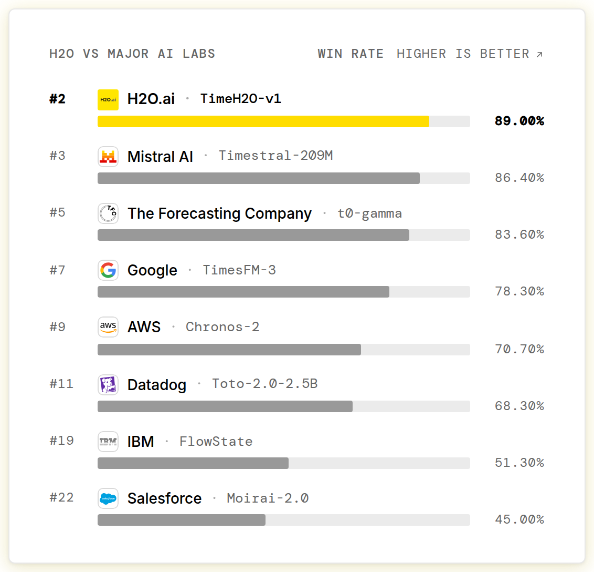
</picture>

| Rank | Company | Model | Win rate |
| ---: | --- | --- | ---: |
| **2** | **H2O.ai** | **TimeH2O-v1** | **89.00%** |
| 3 | Mistral AI | Timestral-209M | 86.40% |
| 5 | The Forecasting Company | t0-gamma | 83.60% |
| 7 | Google | TimesFM-3 | 78.30% |
| 9 | AWS | Chronos-2 | 70.70% |
| 11 | Datadog | Toto-2.0-2.5B | 68.30% |
| 19 | IBM | FlowState | 51.30% |
| 22 | Salesforce | Moirai-2.0 | 45.00% |

### #3 JevBench

*Generative AI · Decision models*

**H2O-Lightning-31B**

<table width="560">
<tr><td colspan="3" width="560">Decision models get a situation and typed questions and must return calibrated answers, scored on intelligence, calibration, speed and cost. A 31B model with open weights.</td></tr>
<tr>
<td width="186" align="center" valign="top"><b><code>87.86</code></b> CAPABILITY SCORE</td>
<td width="186" align="center" valign="top"><b><code>0.25s</code></b> LATENCY INCL. NETWORK</td>
<td width="186" align="center" valign="top"><b><code>$0.021</code></b> PER 1,000 DECISIONS</td>
</tr>
<tr><td colspan="3" width="560"><a href="https://benchmarkheaven.com/jev-models">Leaderboard</a> · <a href="https://benchmarkheaven.com/jev-models/methodology">How it scores</a> · <a href="https://h2o.ai/blog/2026/h2o-lightning-jevbench">H2O blog post</a> · <a href="https://huggingface.co/h2oai/h2o-lightning-31b">Model card</a></td></tr>
</table>

**Capability** · Higher is better

<picture>
  <source media="(prefers-color-scheme: dark)" srcset="readme/carousel-5-jevbench-dark.png">
  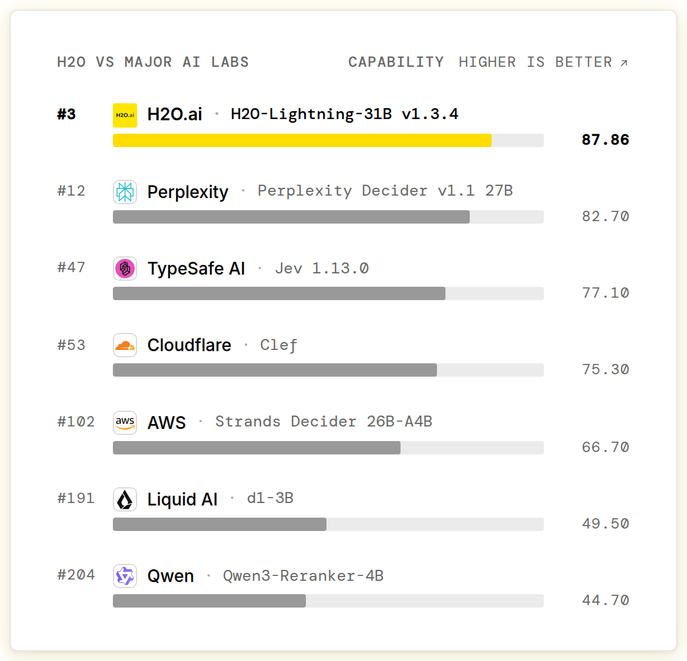
</picture>

| Rank | Company | Model | Capability |
| ---: | --- | --- | ---: |
| **3** | **H2O.ai** | **H2O-Lightning-31B v1.3.4** | **87.86** |
| 12 | Perplexity | Perplexity Decider v1.1 27B | 82.70 |
| 47 | TypeSafe AI | Jev 1.13.0 | 77.10 |
| 53 | Cloudflare | Clef | 75.30 |
| 102 | AWS | Strands Decider 26B-A4B | 66.70 |
| 191 | Liquid AI | d1-3B | 49.50 |
| 204 | Qwen | Qwen3-Reranker-4B | 44.70 |

### #3 ImageJevBench Box Track

*Generative AI · Image boxes*

**H2O-Lightning-4B v1.4.1**

<table width="560">
<tr><td colspan="3" width="560">Models answer with a bounding box and a confidence. Ranks are among 20 ranked systems, scored on 300 public items (546 sealed items are held back for official runs). A preview track: it does not change ImageJevBench&#x27;s own ranking.</td></tr>
<tr>
<td width="186" align="center" valign="top"><b><code>84.90</code></b> CAPABILITY</td>
<td width="186" align="center" valign="top"><b><code>0.28s</code></b> MEDIAN LATENCY</td>
<td width="186" align="center" valign="top"><b><code>$0.096</code></b> PER 1,000 BOXES</td>
</tr>
<tr><td colspan="3" width="560"><a href="https://benchmarkheaven.com/image-jev-bench#box-track">Leaderboard</a> · <a href="https://benchmarkheaven.com/jev-models/methodology">How it scores</a> · <a href="https://huggingface.co/h2oai/h2o-lightning-4b">Model card</a></td></tr>
</table>

**Capability** · Higher is better

<picture>
  <source media="(prefers-color-scheme: dark)" srcset="readme/carousel-6-imagejevbench-box-track-dark.png">
  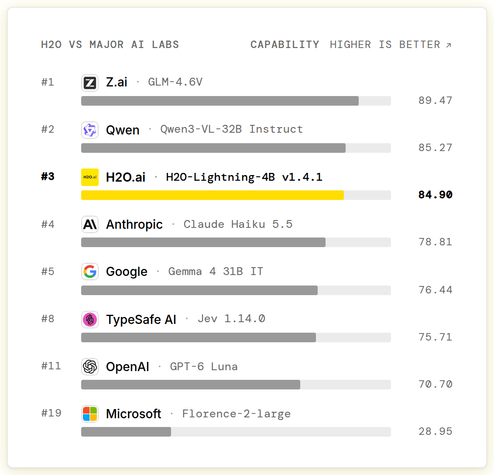
</picture>

| Rank | Company | Model | Capability |
| ---: | --- | --- | ---: |
| 1 | Z.ai | GLM-4.6V | 89.47 |
| 2 | Qwen | Qwen3-VL-32B Instruct | 85.27 |
| **3** | **H2O.ai** | **H2O-Lightning-4B v1.4.1** | **84.90** |
| 4 | Anthropic | Claude Haiku 5.5 | 78.81 |
| 5 | Google | Gemma 4 31B IT | 76.44 |
| 8 | TypeSafe AI | Jev 1.14.0 | 75.71 |
| 11 | OpenAI | GPT-6 Luna | 70.70 |
| 19 | Microsoft | Florence-2-large | 28.95 |

### #5 FutureX

*Agentic AI · Future prediction*

**H2O AI Super Agent**

<table width="560">
<tr><td colspan="4" width="560">Agents predict real-world events before they resolve, with a new board every week, scored once the answers are known. H2O AI Super Agent has earned 26 FutureX medals (9 first places) across 46 weekly boards entered.</td></tr>
<tr>
<td width="140" align="center" valign="top"><b><code>#5</code></b> LATEST WEEKLY BOARD</td>
<td width="140" align="center" valign="top"><b><code>26</code></b> FUTUREX MEDALS</td>
<td width="140" align="center" valign="top"><b><code>9</code></b> FIRST PLACES</td>
<td width="140" align="center" valign="top"><b><code>19 / 46</code></b> BOARDS WITH A MEDAL</td>
</tr>
<tr><td colspan="4" width="560"><a href="https://futurex.live/">Leaderboard</a> · <a href="https://arxiv.org/abs/2508.11987">FutureX paper</a> · <a href="https://h2o.ai/products/h2ogpte">Enterprise h2oGPTe</a></td></tr>
</table>

**Overall score** · Higher is better

<picture>
  <source media="(prefers-color-scheme: dark)" srcset="readme/carousel-7-futurex-dark.png">
  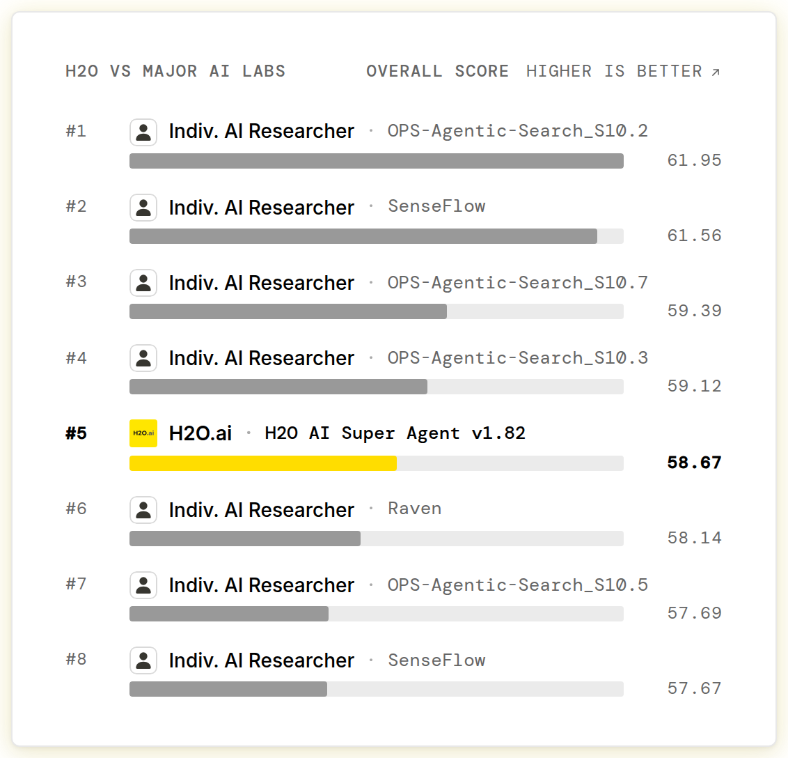
</picture>

| Rank | Company | Model | Overall score |
| ---: | --- | --- | ---: |
| 1 | Indiv. AI Researcher | OPS-Agentic-Search\_S10.2 | 61.95 |
| 2 | Indiv. AI Researcher | SenseFlow | 61.56 |
| 3 | Indiv. AI Researcher | OPS-Agentic-Search\_S10.7 | 59.39 |
| 4 | Indiv. AI Researcher | OPS-Agentic-Search\_S10.3 | 59.12 |
| **5** | **H2O.ai** | **H2O AI Super Agent v1.82** | **58.67** |
| 6 | Indiv. AI Researcher | Raven | 58.14 |
| 7 | Indiv. AI Researcher | OPS-Agentic-Search\_S10.5 | 57.69 |
| 8 | Indiv. AI Researcher | SenseFlow | 57.67 |

[↑ Back to top](#top)

## The benchmarks in detail

### #2 fev-bench

*Predictive AI · Time-series forecasting*

**TimeH2O-v1**

<table width="560">
<tr><td colspan="3" width="560">Zero-shot forecasting on real time series across many domains and frequencies, scored by probabilistic accuracy against a seasonal-naive baseline. 108.8M parameters.</td></tr>
<tr>
<td width="186" align="center" valign="top"><b><code>89.00%</code></b> WIN RATE</td>
<td width="186" align="center" valign="top"><b><code>50.80%</code></b> SKILL SCORE</td>
<td width="186" align="center" valign="top"><b><code>108.8M</code></b> PARAMETERS</td>
</tr>
<tr><td colspan="3" width="560"><a href="https://huggingface.co/spaces/autogluon/fev-bench">Leaderboard</a> · <a href="https://arxiv.org/abs/2509.26468">fev-bench paper</a> · <a href="https://huggingface.co/h2oai/timeh2o-v1">Model card</a></td></tr>
</table>

**Win rate · top 10** · Higher is better

<picture>
  <source media="(prefers-color-scheme: dark)" srcset="readme/fev-bench-dark.png">
  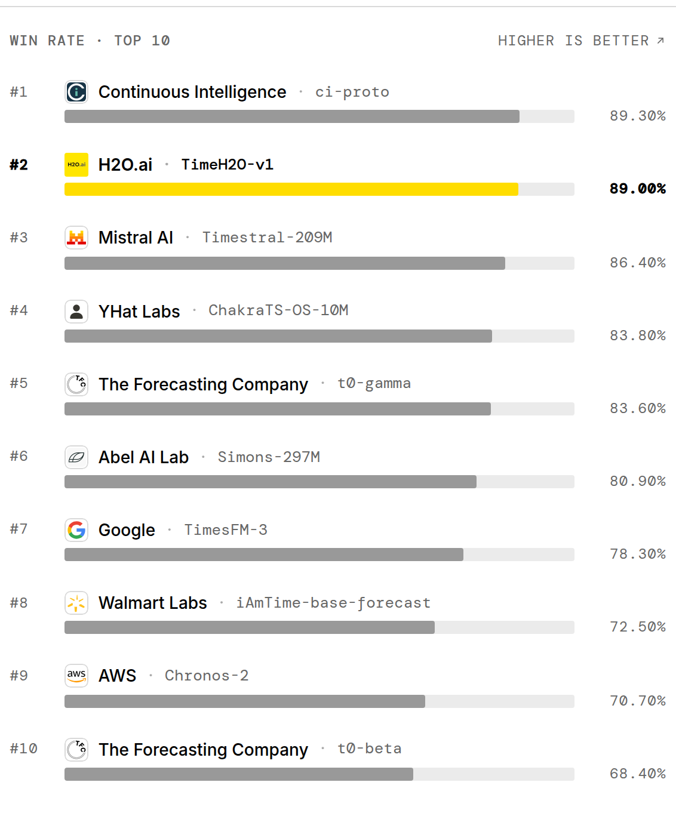
</picture>

| Rank | Company | Model | Score |
| ---: | --- | --- | ---: |
| 1 | Continuous Intelligence | ci-proto | 89.30% |
| **2** | **H2O.ai** | **TimeH2O-v1** | **89.00%** |
| 3 | Mistral AI | Timestral-209M | 86.40% |
| 4 | YHat Labs | ChakraTS-OS-10M | 83.80% |
| 5 | The Forecasting Company | t0-gamma | 83.60% |
| 6 | Abel AI Lab | Simons-297M | 80.90% |
| 7 | Google | TimesFM-3 | 78.30% |
| 8 | Walmart Labs | iAmTime-base-forecast | 72.50% |
| 9 | AWS | Chronos-2 | 70.70% |
| 10 | The Forecasting Company | t0-beta | 68.40% |

[↑ Back to top](#top)

### #1 EnergyBench by Foretec

*Predictive AI · Energy forecasting*

**TimeH2O-v1**

<table width="560">
<tr><td colspan="3" width="560">Day-ahead electricity forecasting in six European zones, scored every day against the grid operators&#x27; own figures. Ranked by Elo on the board&#x27;s default view (all zones, all four targets) over 53 live days to November 24. Data and scores: CC BY 4.0.</td></tr>
<tr>
<td width="186" align="center" valign="top"><b><code>1195</code></b> ELO</td>
<td width="186" align="center" valign="top"><b><code>74.10%</code></b> WIN RATE</td>
<td width="186" align="center" valign="top"><b><code>66.60%</code></b> SKILL SCORE</td>
</tr>
<tr><td colspan="3" width="560"><a href="https://energybench.foretec.co/">Leaderboard</a> · <a href="https://energybench.foretec.co/methodology.html">How it scores</a> · <a href="https://huggingface.co/h2oai/timeh2o-v1">Model card</a> · <a href="https://creativecommons.org/licenses/by/4.0/">CC BY 4.0</a></td></tr>
</table>

**Elo · top 10** · Higher is better

<picture>
  <source media="(prefers-color-scheme: dark)" srcset="readme/energybench-dark.png">
  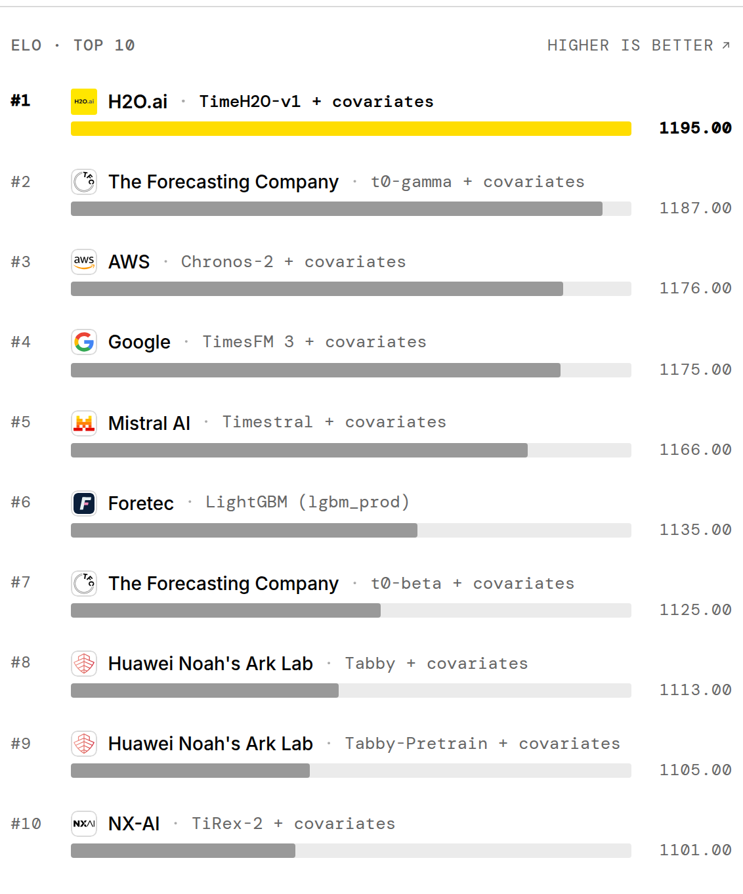
</picture>

| Rank | Company | Model | Score |
| ---: | --- | --- | ---: |
| **1** | **H2O.ai** | **TimeH2O-v1 + covariates** | **1195.00** |
| 2 | The Forecasting Company | t0-gamma + covariates | 1185.00 |
| 3 | Google | TimesFM 3 + covariates | 1172.00 |
| 4 | AWS | Chronos-2 + covariates | 1170.00 |
| 5 | Mistral AI | Timestral + covariates | 1160.00 |
| 6 | Foretec | LightGBM (lgbm\_prod) | 1142.00 |
| 7 | The Forecasting Company | t0-beta + covariates | 1125.00 |
| 8 | Huawei Noah's Ark Lab | Tabby + covariates | 1110.00 |
| 9 | Huawei Noah's Ark Lab | Tabby-Pretrain + covariates | 1102.00 |
| 10 | NX-AI | TiRex-2 + covariates | 1097.00 |

[↑ Back to top](#top)

### #1 ImageJevBench

*Generative AI · Image decision models*

**H2O-Lightning-31B**

<table width="560">
<tr><td colspan="3" width="560">Image decision models answer typed questions about a picture and must return calibrated answers, scored on intelligence, calibration, speed and cost. An open-weights model.</td></tr>
<tr>
<td width="186" align="center" valign="top"><b><code>80.88</code></b> CAPABILITY SCORE</td>
<td width="186" align="center" valign="top"><b><code>0.59s</code></b> LATENCY INCL. NETWORK</td>
<td width="186" align="center" valign="top"><b><code>$0.075</code></b> PER 1,000 DECISIONS</td>
</tr>
<tr><td colspan="3" width="560"><a href="https://benchmarkheaven.com/image-jev-bench">Leaderboard</a> · <a href="https://benchmarkheaven.com/jev-models/methodology">How it scores</a> · <a href="https://huggingface.co/h2oai/h2o-lightning-31b">Model card</a></td></tr>
</table>

**Capability · top 10** · Higher is better

<picture>
  <source media="(prefers-color-scheme: dark)" srcset="readme/imagejevbench-capability-dark.png">
  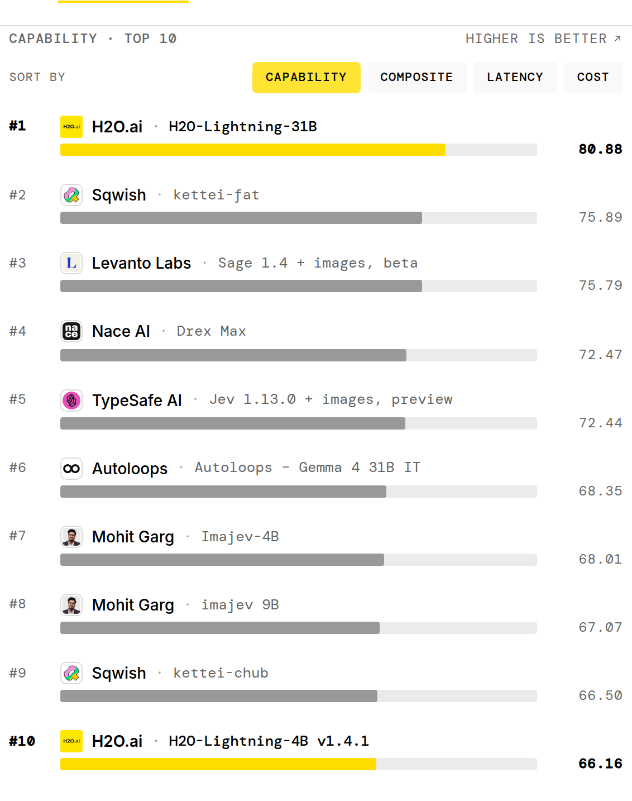
</picture>

| Rank | Company | Model | Capability |
| ---: | --- | --- | ---: |
| **1** | **H2O.ai** | **H2O-Lightning-31B** | **80.88** |
| **2** | **H2O.ai** | **H2O-Lightning-31B v1.3.4 @c35ed950** | **80.34** |
| 3 | Sqwish | kettei-fat | 75.89 |
| 4 | Levanto Labs | Sage 1.4 + images, beta | 75.79 |
| 5 | Nace AI | Drex Max | 72.47 |
| 6 | TypeSafe AI | Jev 1.13.0 + images, preview | 72.44 |
| 7 | Autoloops | Autoloops – Gemma 4 31B IT | 68.35 |
| 8 | Mohit Garg | Imajev-4B | 68.01 |
| 9 | Mohit Garg | imajev 9B | 67.07 |
| 10 | Sqwish | kettei-chub | 66.50 |

<b>Composite · top 10</b> · Higher is better

<picture>
  <source media="(prefers-color-scheme: dark)" srcset="readme/imagejevbench-composite-dark.png">
  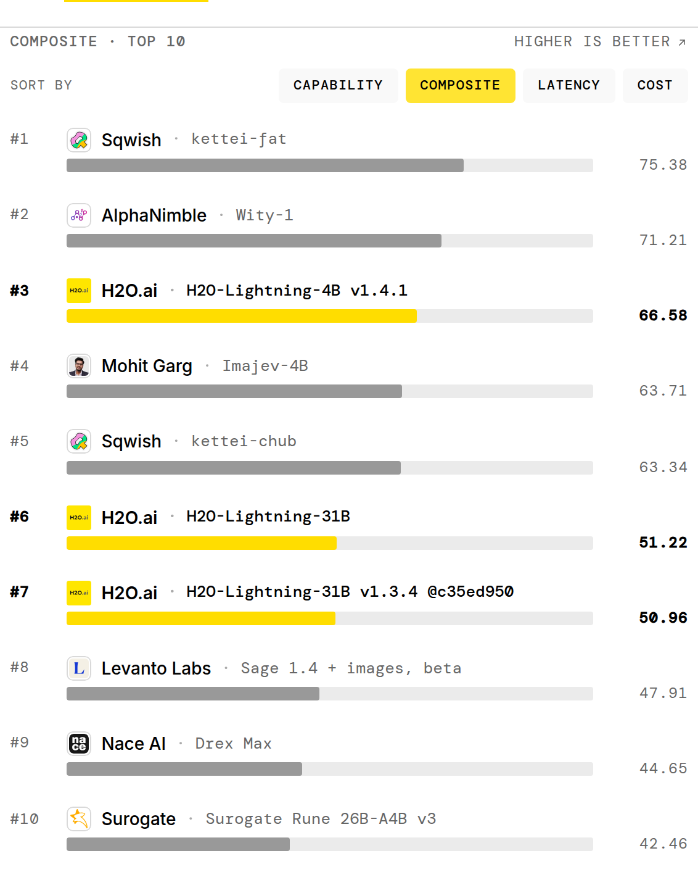
</picture>

| Rank | Company | Model | Composite |
| ---: | --- | --- | ---: |
| 1 | Sqwish | kettei-fat | 75.38 |
| 2 | AlphaNimble | Wity-1 | 71.21 |
| **3** | **H2O.ai** | **H2O-Lightning-4B v1.4.1** | **66.58** |
| 4 | Mohit Garg | Imajev-4B | 63.71 |
| 5 | Sqwish | kettei-chub | 63.34 |
| **6** | **H2O.ai** | **H2O-Lightning-31B** | **51.22** |
| **7** | **H2O.ai** | **H2O-Lightning-31B v1.3.4 @c35ed950** | **50.96** |
| 8 | Levanto Labs | Sage 1.4 + images, beta | 47.91 |
| 9 | Nace AI | Drex Max | 44.65 |
| 10 | Surogate | Surogate Rune 26B-A4B v3 | 42.46 |

<b>Latency · composite top 10</b> · Lower is better

<picture>
  <source media="(prefers-color-scheme: dark)" srcset="readme/imagejevbench-latency-dark.png">
  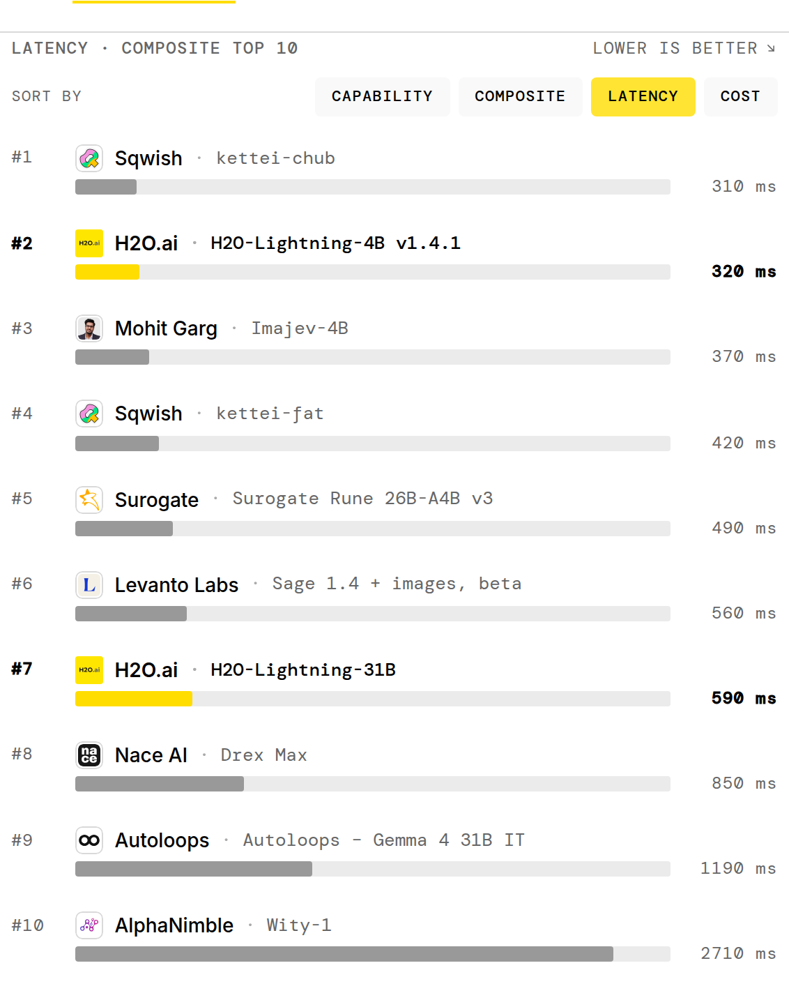
</picture>

| Rank | Company | Model | Latency |
| ---: | --- | --- | ---: |
| 1 | Sqwish | kettei-chub | 310 ms |
| **2** | **H2O.ai** | **H2O-Lightning-4B v1.4.1** | **320 ms** |
| 3 | Mohit Garg | Imajev-4B | 370 ms |
| 4 | Sqwish | kettei-fat | 420 ms |
| 5 | Surogate | Surogate Rune 26B-A4B v3 | 490 ms |
| 6 | Levanto Labs | Sage 1.4 + images, beta | 560 ms |
| **7** | **H2O.ai** | **H2O-Lightning-31B** | **590 ms** |
| **8** | **H2O.ai** | **H2O-Lightning-31B v1.3.4 @c35ed950** | **590 ms** |
| 9 | Nace AI | Drex Max | 850 ms |
| 10 | AlphaNimble | Wity-1 | 2710 ms |

<b>Cost · composite top 10</b> · Lower is better

<picture>
  <source media="(prefers-color-scheme: dark)" srcset="readme/imagejevbench-cost-dark.png">
  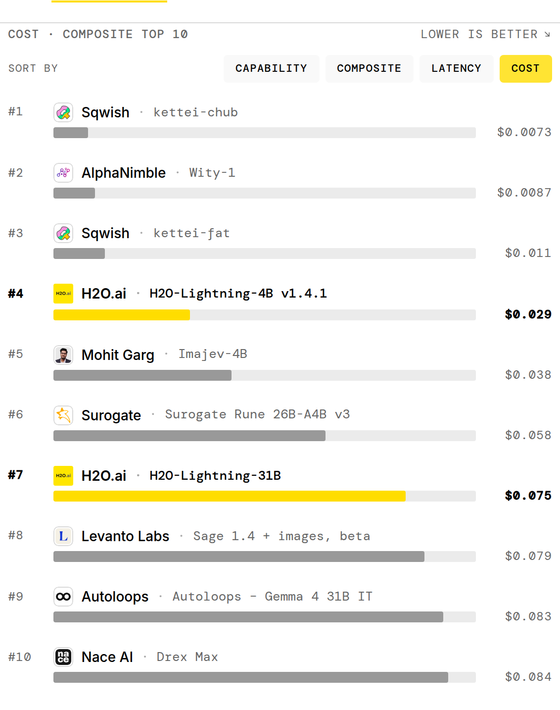
</picture>

| Rank | Company | Model | Cost |
| ---: | --- | --- | ---: |
| 1 | Sqwish | kettei-chub | \$0.0073 |
| 2 | AlphaNimble | Wity-1 | \$0.0087 |
| 3 | Sqwish | kettei-fat | \$0.011 |
| **4** | **H2O.ai** | **H2O-Lightning-4B v1.4.1** | **\$0.029** |
| 5 | Mohit Garg | Imajev-4B | \$0.038 |
| 6 | Surogate | Surogate Rune 26B-A4B v3 | \$0.058 |
| **7** | **H2O.ai** | **H2O-Lightning-31B** | **\$0.075** |
| **8** | **H2O.ai** | **H2O-Lightning-31B v1.3.4 @c35ed950** | **\$0.075** |
| 9 | Levanto Labs | Sage 1.4 + images, beta | \$0.079 |
| 10 | Nace AI | Drex Max | \$0.084 |

[↑ Back to top](#top)

### #3 ImageJevBench Box Track

*Generative AI · Image boxes*

**H2O-Lightning-4B v1.4.1**

<table width="560">
<tr><td colspan="3" width="560">Models answer with a bounding box and a confidence. Ranks are among 20 ranked systems, scored on 300 public items (546 sealed items are held back for official runs). A preview track: it does not change ImageJevBench&#x27;s own ranking.</td></tr>
<tr>
<td width="186" align="center" valign="top"><b><code>84.90</code></b> CAPABILITY</td>
<td width="186" align="center" valign="top"><b><code>0.28s</code></b> MEDIAN LATENCY</td>
<td width="186" align="center" valign="top"><b><code>$0.096</code></b> PER 1,000 BOXES</td>
</tr>
<tr><td colspan="3" width="560"><a href="https://benchmarkheaven.com/image-jev-bench#box-track">Leaderboard</a> · <a href="https://benchmarkheaven.com/jev-models/methodology">How it scores</a> · <a href="https://huggingface.co/h2oai/h2o-lightning-4b">Model card</a></td></tr>
</table>

**Capability · top 10** · Higher is better

<picture>
  <source media="(prefers-color-scheme: dark)" srcset="readme/imagejevbench-box-track-dark.png">
  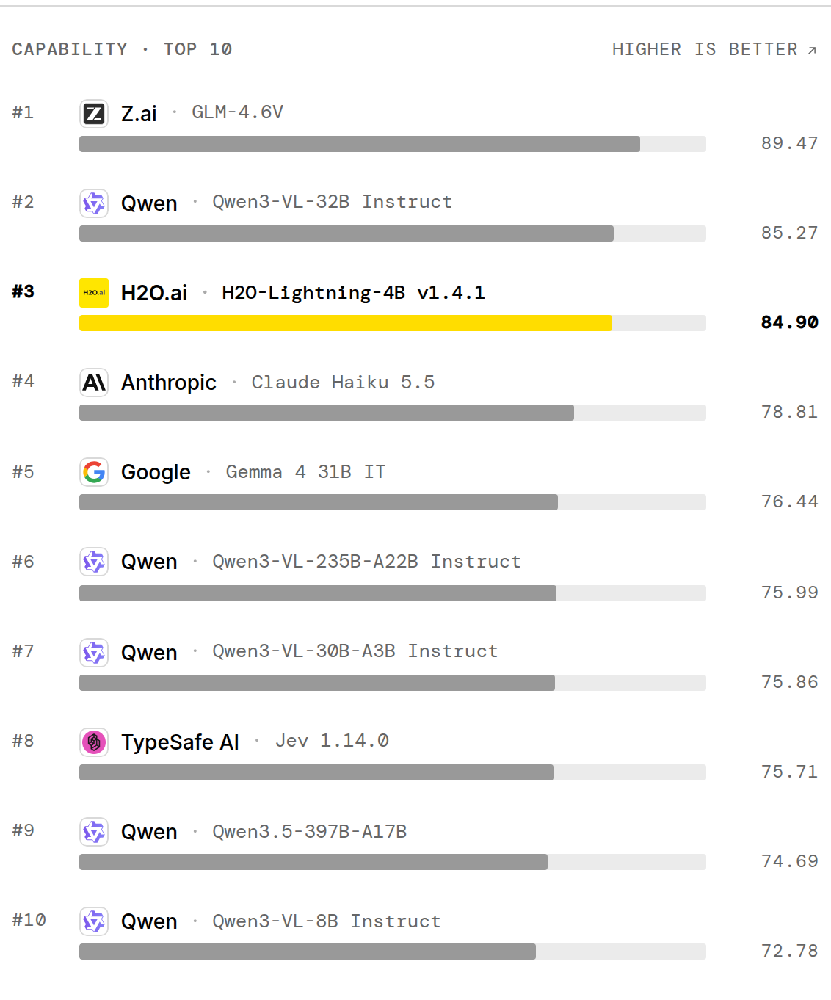
</picture>

| Rank | Company | Model | Score |
| ---: | --- | --- | ---: |
| 1 | Z.ai | GLM-4.6V | 89.47 |
| 2 | Qwen | Qwen3-VL-32B Instruct | 85.27 |
| **3** | **H2O.ai** | **H2O-Lightning-4B v1.4.1** | **84.90** |
| 4 | Anthropic | Claude Haiku 5.5 | 78.81 |
| 5 | Google | Gemma 4 31B IT | 76.44 |
| 6 | Qwen | Qwen3-VL-235B-A22B Instruct | 75.99 |
| 7 | Qwen | Qwen3-VL-30B-A3B Instruct | 75.86 |
| 8 | TypeSafe AI | Jev 1.14.0 | 75.71 |
| 9 | Qwen | Qwen3.5-397B-A17B | 74.69 |
| 10 | Qwen | Qwen3-VL-8B Instruct | 72.78 |

[↑ Back to top](#top)

### #3 JevBench

*Generative AI · Decision models*

**H2O-Lightning-31B**

<table width="560">
<tr><td colspan="3" width="560">Decision models get a situation and typed questions and must return calibrated answers, scored on intelligence, calibration, speed and cost. A 31B model with open weights.</td></tr>
<tr>
<td width="186" align="center" valign="top"><b><code>87.86</code></b> CAPABILITY SCORE</td>
<td width="186" align="center" valign="top"><b><code>0.25s</code></b> LATENCY INCL. NETWORK</td>
<td width="186" align="center" valign="top"><b><code>$0.021</code></b> PER 1,000 DECISIONS</td>
</tr>
<tr><td colspan="3" width="560"><a href="https://benchmarkheaven.com/jev-models">Leaderboard</a> · <a href="https://benchmarkheaven.com/jev-models/methodology">How it scores</a> · <a href="https://h2o.ai/blog/2026/h2o-lightning-jevbench">H2O blog post</a> · <a href="https://huggingface.co/h2oai/h2o-lightning-31b">Model card</a></td></tr>
</table>

**Capability · top 10** · Higher is better

<picture>
  <source media="(prefers-color-scheme: dark)" srcset="readme/jevbench-capability-dark.png">
  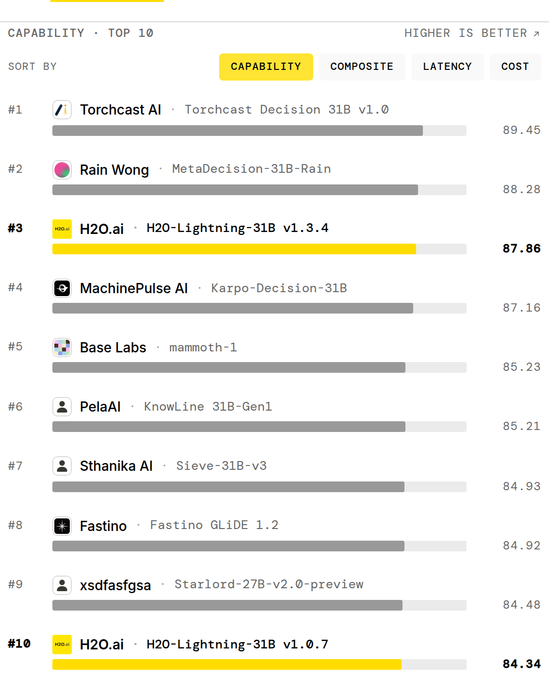
</picture>

| Rank | Company | Model | Capability |
| ---: | --- | --- | ---: |
| 1 | Torchcast AI | Torchcast Decision 31B v1.0 | 89.45 |
| 2 | Rain Wong | MetaDecision-31B-Rain | 88.28 |
| **3** | **H2O.ai** | **H2O-Lightning-31B v1.3.4** | **87.86** |
| 4 | MachinePulse AI | Karpo-Decision-31B | 87.16 |
| 5 | Base Labs | mammoth-1 | 85.23 |
| 6 | PelaAI | KnowLine 31B-Gen1 | 85.21 |
| 7 | Sthanika AI | Sieve-31B-v3 | 84.93 |
| 8 | Fastino | Fastino GLiDE 1.2 | 84.92 |
| 9 | xsdfasfgsa | Starlord-27B-v2.0-preview | 84.48 |
| **10** | **H2O.ai** | **H2O-Lightning-31B v1.0.7** | **84.34** |

<b>Composite · top 10</b> · Higher is better

<picture>
  <source media="(prefers-color-scheme: dark)" srcset="readme/jevbench-composite-dark.png">
  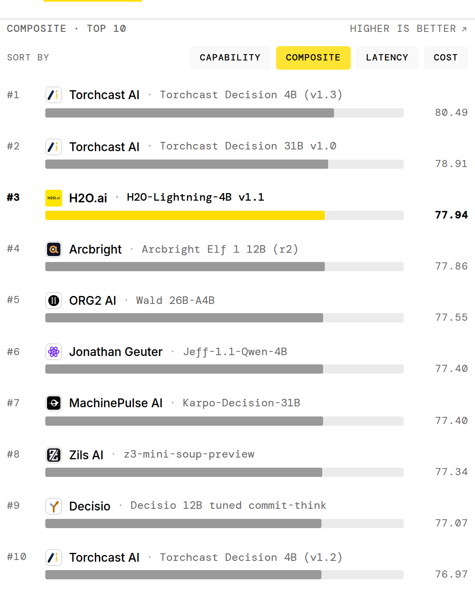
</picture>

| Rank | Company | Model | Composite |
| ---: | --- | --- | ---: |
| 1 | Torchcast AI | Torchcast Decision 4B (v1.3) | 80.49 |
| **2** | **H2O.ai** | **H2O-Lightning-31B v1.3.4** | **79.25** |
| 3 | Torchcast AI | Torchcast Decision 31B v1.0 | 78.91 |
| **4** | **H2O.ai** | **H2O-Lightning-4B v1.1** | **77.94** |
| 5 | Arcbright | Arcbright Elf 1 12B (r2) | 77.86 |
| 6 | ORG2 AI | Wald 26B-A4B | 77.55 |
| 7 | xsdfasfgsa | Starlord-27B-v2.0-preview | 77.41 |
| 8 | Jonathan Geuter | Jeff-1.1-Qwen-4B | 77.40 |
| 9 | MachinePulse AI | Karpo-Decision-31B | 77.40 |
| 10 | Zils AI | z3-mini-soup-preview | 77.34 |

<b>Latency · composite top 10</b> · Lower is better

<picture>
  <source media="(prefers-color-scheme: dark)" srcset="readme/jevbench-latency-dark.png">
  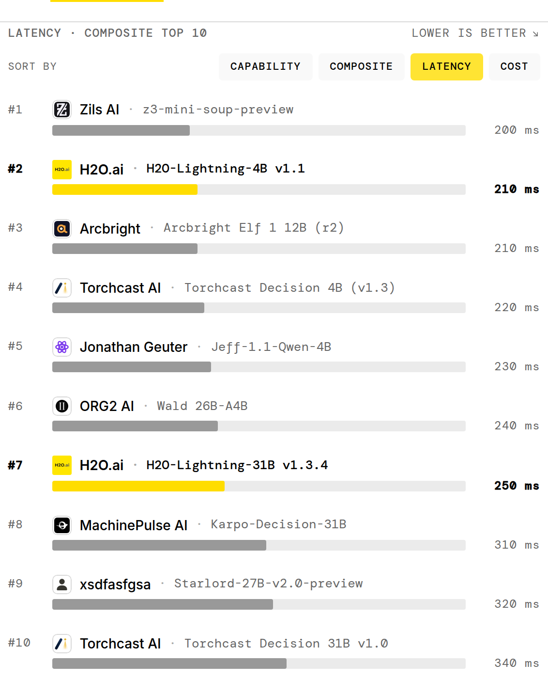
</picture>

| Rank | Company | Model | Latency |
| ---: | --- | --- | ---: |
| 1 | Zils AI | z3-mini-soup-preview | 200 ms |
| **2** | **H2O.ai** | **H2O-Lightning-4B v1.1** | **210 ms** |
| 3 | Arcbright | Arcbright Elf 1 12B (r2) | 210 ms |
| 4 | Torchcast AI | Torchcast Decision 4B (v1.3) | 220 ms |
| 5 | Jonathan Geuter | Jeff-1.1-Qwen-4B | 230 ms |
| 6 | ORG2 AI | Wald 26B-A4B | 240 ms |
| **7** | **H2O.ai** | **H2O-Lightning-31B v1.3.4** | **250 ms** |
| 8 | MachinePulse AI | Karpo-Decision-31B | 310 ms |
| 9 | xsdfasfgsa | Starlord-27B-v2.0-preview | 320 ms |
| 10 | Torchcast AI | Torchcast Decision 31B v1.0 | 340 ms |

<b>Cost · composite top 10</b> · Lower is better

<picture>
  <source media="(prefers-color-scheme: dark)" srcset="readme/jevbench-cost-dark.png">
  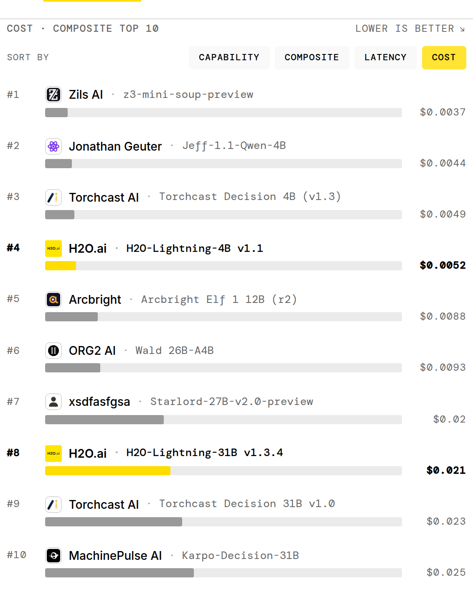
</picture>

| Rank | Company | Model | Cost |
| ---: | --- | --- | ---: |
| 1 | Zils AI | z3-mini-soup-preview | \$0.0037 |
| 2 | Jonathan Geuter | Jeff-1.1-Qwen-4B | \$0.0044 |
| 3 | Torchcast AI | Torchcast Decision 4B (v1.3) | \$0.0049 |
| **4** | **H2O.ai** | **H2O-Lightning-4B v1.1** | **\$0.0052** |
| 5 | Arcbright | Arcbright Elf 1 12B (r2) | \$0.0088 |
| 6 | ORG2 AI | Wald 26B-A4B | \$0.0093 |
| 7 | xsdfasfgsa | Starlord-27B-v2.0-preview | \$0.02 |
| **8** | **H2O.ai** | **H2O-Lightning-31B v1.3.4** | **\$0.021** |
| 9 | Torchcast AI | Torchcast Decision 31B v1.0 | \$0.023 |
| 10 | MachinePulse AI | Karpo-Decision-31B | \$0.025 |

[↑ Back to top](#top)

### #5 TALENT

*Predictive AI · Tabular foundation models*

**TabH2O v1.1**

<table width="560">
<tr><td colspan="4" width="560">Two public benchmark suites of tabular classification and regression datasets, comparing tabular foundation models, AutoML, and tuned gradient boosting across 300 datasets on TALENT and 51 datasets on TabArena.</td></tr>
<tr>
<td width="140" align="center" valign="top"><b><code>#5 / 13</code></b> TALENT RANK</td>
<td width="140" align="center" valign="top"><b><code>300</code></b> TALENT DATASETS</td>
<td width="140" align="center" valign="top"><b><code>#7 / 39</code></b> TABARENA RANK</td>
<td width="140" align="center" valign="top"><b><code>51</code></b> TABARENA DATASETS</td>
</tr>
<tr><td colspan="4" width="560"><a href="https://github.com/LAMDA-Tabular/TALENT">TALENT</a> · <a href="https://tabarena.ai">TabArena</a> · <a href="https://h2o.ai/blog/2026/h2oai-unveils-tabh2o-at-dell-technologies-world-2026">Introducing TabH2O</a> · <a href="https://arxiv.org/abs/2605.18383">TabH2O paper</a> · <a href="https://h2o.ai/products/tabh2o">TabH2O</a></td></tr>
</table>

**TALENT · average rank across datasets · top 10** · Lower is better

<picture>
  <source media="(prefers-color-scheme: dark)" srcset="readme/tabh2o-talent-dark.png">
  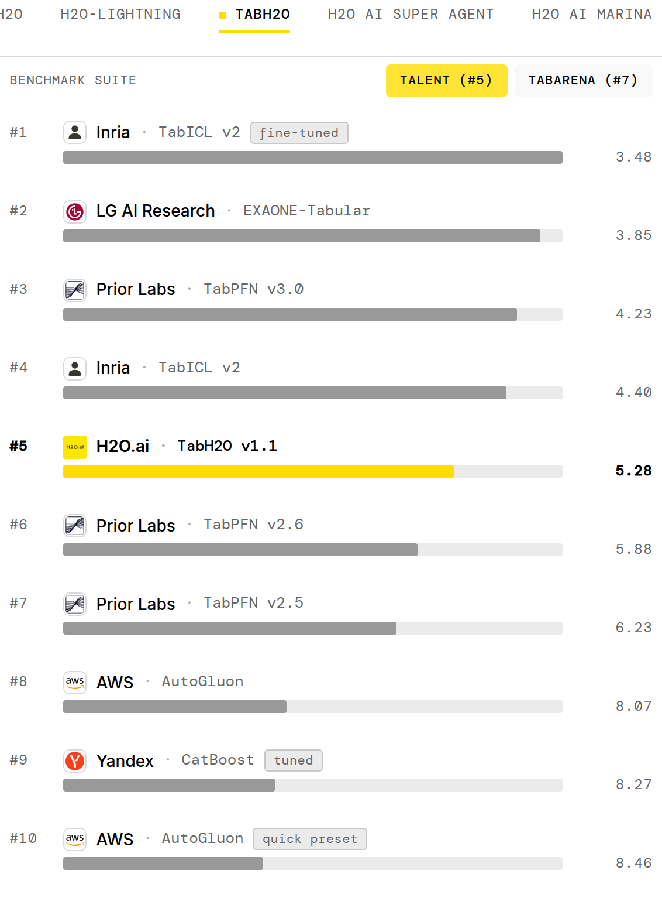
</picture>

| Rank | Company | Model | Average rank |
| ---: | --- | --- | ---: |
| 1 | Inria | TabICL v2 (fine-tuned) | 3.48 |
| 2 | LG AI Research | EXAONE-Tabular | 3.85 |
| 3 | Prior Labs | TabPFN v3.0 | 4.23 |
| 4 | Inria | TabICL v2 | 4.40 |
| **5** | **H2O.ai** | **TabH2O v1.1** | **5.28** |
| 6 | Prior Labs | TabPFN v2.6 | 5.88 |
| 7 | Prior Labs | TabPFN v2.5 | 6.23 |
| 8 | AWS | AutoGluon | 8.07 |
| 9 | Yandex | CatBoost (tuned) | 8.27 |
| 10 | AWS | AutoGluon (quick preset) | 8.46 |

<b>TabArena · average rank across datasets · top 10</b> · Lower is better

<picture>
  <source media="(prefers-color-scheme: dark)" srcset="readme/tabh2o-tabarena-dark.png">
  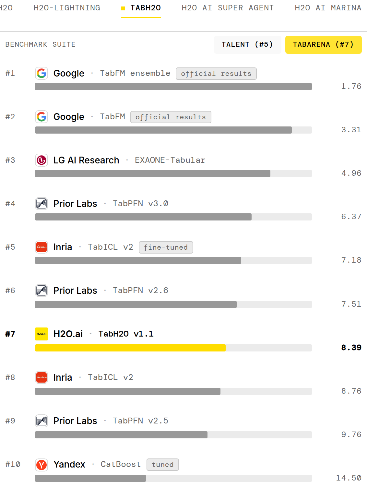
</picture>

| Rank | Company | Model | Average rank |
| ---: | --- | --- | ---: |
| 1 | Google | TabFM ensemble (official results) | 1.76 |
| 2 | Google | TabFM (official results) | 3.31 |
| 3 | LG AI Research | EXAONE-Tabular | 4.96 |
| 4 | Prior Labs | TabPFN v3.0 | 6.37 |
| 5 | Inria | TabICL v2 (fine-tuned) | 7.18 |
| 6 | Prior Labs | TabPFN v2.6 | 7.51 |
| **7** | **H2O.ai** | **TabH2O v1.1** | **8.39** |
| 8 | Inria | TabICL v2 | 8.76 |
| 9 | Prior Labs | TabPFN v2.5 | 9.76 |
| 10 | Yandex | CatBoost (tuned) | 14.50 |

[↑ Back to top](#top)

### #5 FutureX

*Agentic AI · Future prediction*

**H2O AI Super Agent**

<table width="560">
<tr><td colspan="4" width="560">Agents predict real-world events before they resolve, with a new board every week, scored once the answers are known. H2O AI Super Agent has earned 26 FutureX medals (9 first places) across 46 weekly boards entered.</td></tr>
<tr>
<td width="140" align="center" valign="top"><b><code>#5</code></b> LATEST WEEKLY BOARD</td>
<td width="140" align="center" valign="top"><b><code>26</code></b> FUTUREX MEDALS</td>
<td width="140" align="center" valign="top"><b><code>9</code></b> FIRST PLACES</td>
<td width="140" align="center" valign="top"><b><code>19 / 46</code></b> BOARDS WITH A MEDAL</td>
</tr>
<tr><td colspan="4" width="560"><a href="https://futurex.live/">Leaderboard</a> · <a href="https://arxiv.org/abs/2508.11987">FutureX paper</a> · <a href="https://h2o.ai/products/h2ogpte">Enterprise h2oGPTe</a></td></tr>
</table>

**Overall score, weekly board · top 10** · Higher is better

<picture>
  <source media="(prefers-color-scheme: dark)" srcset="readme/futurex-dark.png">
  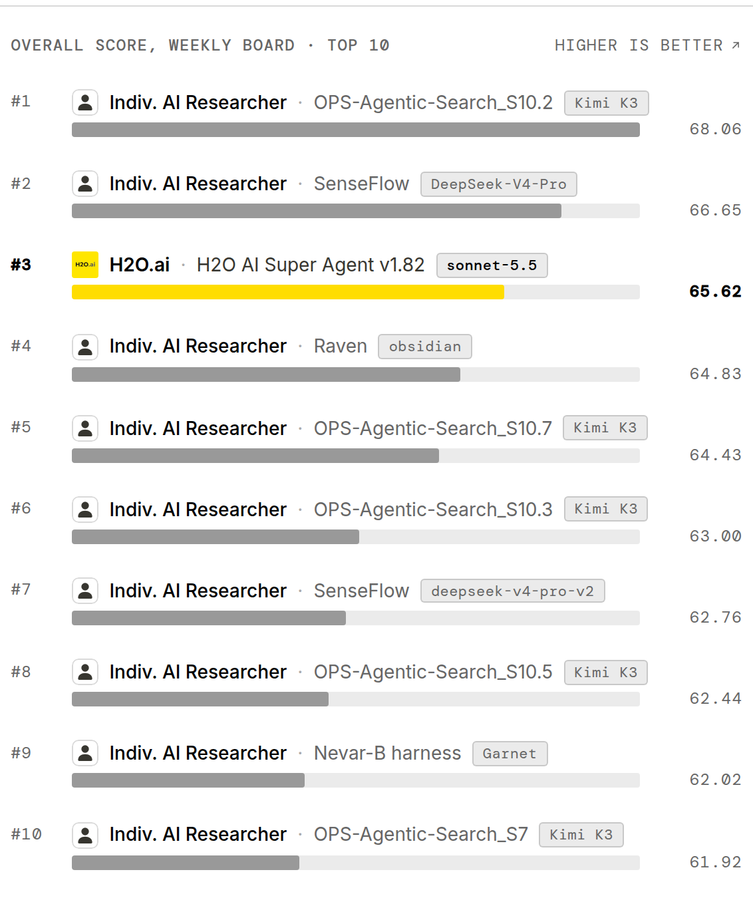
</picture>

| Rank | Company | Framework | Base model | Score |
| ---: | --- | --- | --- | ---: |
| 1 | Indiv. AI Researcher | OPS-Agentic-Search\_S10.2 | Kimi K3 | 61.95 |
| 2 | Indiv. AI Researcher | SenseFlow | DeepSeek-V4-Pro | 61.56 |
| 3 | Indiv. AI Researcher | OPS-Agentic-Search\_S10.7 | Kimi K3 | 59.39 |
| 4 | Indiv. AI Researcher | OPS-Agentic-Search\_S10.3 | Kimi K3 | 59.12 |
| **5** | **H2O.ai** | **H2O AI Super Agent v1.82** | **sonnet-5.5** | **58.67** |
| 6 | Indiv. AI Researcher | Raven | obsidian | 58.14 |
| 7 | Indiv. AI Researcher | OPS-Agentic-Search\_S10.5 | Kimi K3 | 57.69 |
| 8 | Indiv. AI Researcher | SenseFlow | deepseek-v4-pro-v2 | 57.67 |
| 9 | Indiv. AI Researcher | OPS-Agentic-Search\_S7 | Kimi K3 | 57.17 |
| 10 | Indiv. AI Researcher | OPS-Agentic-Search\_S1 | Kimi K3 | 56.72 |

[↑ Back to top](#top)

### #1 Social Simulation Arena

*Agentic AI · Social forecasting*

**H2O AI Super Agent** · **#3 H2O AI Marina**

<table width="560">
<tr><td colspan="3" width="560">Entrants forecast the next public release of poll, sentiment and attention series. Forecasts are locked before the answer exists and scored against the published number.</td></tr>
<tr>
<td width="186" align="center" valign="top"><b><code>68.59</code></b> PAIRWISE WIN RATE</td>
<td width="186" align="center" valign="top"><b><code>85</code></b> QUESTIONS ANSWERED</td>
<td width="186" align="center" valign="top"><b><code>+28.55</code></b> AHEAD OF ANTHROPIC</td>
</tr>
<tr><td colspan="3" width="560"><a href="https://social-simulation-arena.com/#leaderboard">Leaderboard</a> · <a href="https://h2o.ai/products/h2ogpte">Enterprise h2oGPTe</a> · <a href="https://h2oai.github.io/marina/">H2O AI Marina</a></td></tr>
</table>

**Pairwise win rate · top 10** · Higher is better

<picture>
  <source media="(prefers-color-scheme: dark)" srcset="readme/social-simulation-arena-dark.png">
  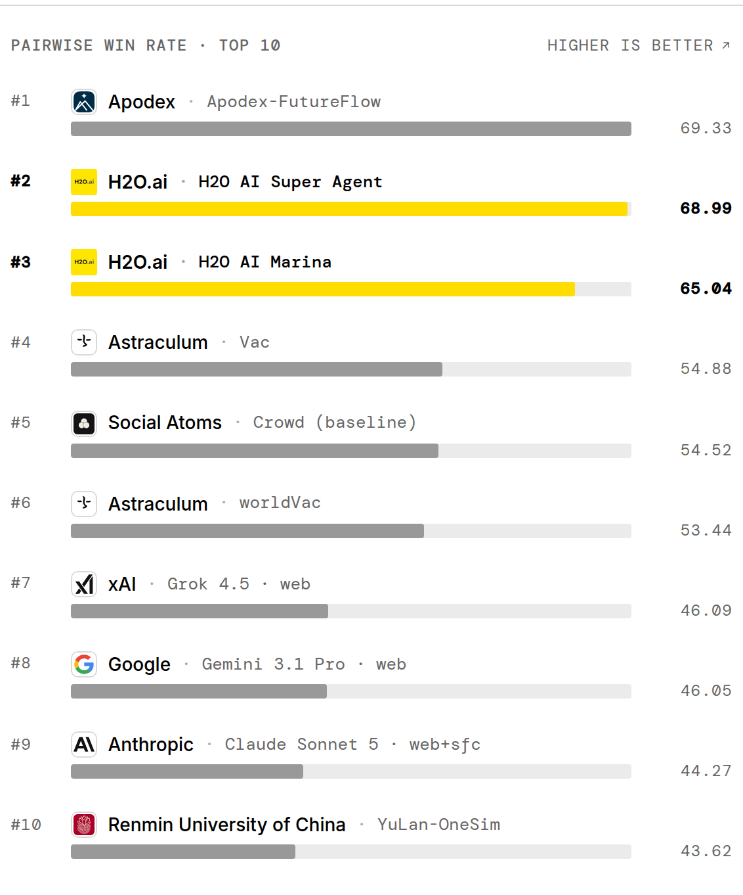
</picture>

| Rank | Company | Model | Score |
| ---: | --- | --- | ---: |
| **1** | **H2O.ai** | **H2O AI Super Agent** | **68.59** |
| 2 | Apodex | Apodex-FutureFlow | 67.52 |
| **3** | **H2O.ai** | **H2O AI Marina** | **61.79** |
| 4 | Astraculum | Vac | 57.14 |
| 5 | Astraculum | worldVac | 54.37 |
| 6 | Social Atoms | Crowd (baseline) | 51.41 |
| 7 | ? | Persistence | 44.12 |
| 8 | Google | Gemini 3.1 Pro · web | 40.21 |
| 9 | Google | Gemini 3.1 Pro · web+sfc | 40.13 |
| 10 | Renmin University of China | YuLan-OneSim | 40.09 |

[↑ Back to top](#top)

---

[Download all data (CSV)](site/data/h2o-benchmarks.csv)
<!-- benchmarks:end -->
